# Soulrip — Backend


> **Discover Solo → Plan Solo → Share Solo**
> 서울 공공 관광 데이터와 서울관광 실태조사(2024~2026)를 근거로, 혼자 여행하는 사람이 장소를 발견하고 일정을 구체화하고 경험을 공유하도록 돕는 **AI 기반 Solo Travel Hub의 백엔드 API**이다.

이 저장소는 Soulrip의 **REST API, 데이터 계층, AI 연동, RAG(검색 증강 생성)** 를 담당한다. 서울 관광 JSON 데이터를 SQLite에 적재해 장소·축제·코스·커뮤니티·여행 기록 API를 제공하고, 챗봇은 저장된 데이터와 **서울관광 실태조사·서울시 공공데이터 RAG 인덱스**를 근거로만 답한다.

---

## Table of Contents

1. [Project Repositories](#project-repositories)
2. [Key Features](#key-features)
3. [Tech Stack](#tech-stack)
4. [Architecture](#architecture)
5. [Directory Structure](#directory-structure)
6. [Getting Started](#getting-started)
7. [API Documentation](#api-documentation)
8. [AI Chatbot & RAG](#ai-chatbot--rag)
9. [RAG Evaluation](#rag-evaluation)
10. [Data Model](#data-model)
11. [Performance Optimization & Troubleshooting](#performance-optimization--troubleshooting)
12. [Testing & Verification](#testing--verification)
13. [Deployment](#deployment)
14. [Frontend Integration](#frontend-integration)
15. [Security Notes](#security-notes)
16. [Contributing](#contributing)
17. [Harness Engineering](#harness-engineering)

---

## Project Repositories

| Repository | Role | Link |
| --- | --- | --- |
| Frontend | Vue 3 기반 사용자 화면과 상호작용 | https://github.com/Soulrip-Trip/soul-frontend |
| Backend | FastAPI 기반 REST API, 데이터 처리, AI·RAG 연동 | https://github.com/Soulrip-Trip/soul-backend |

프론트엔드는 사용자 경험과 화면 상태를, 백엔드는 데이터 조회·가공·영속화와 외부 AI·RAG 연동을 담당한다. **RAG는 서버 내부에서만 동작**하며 프론트엔드는 기존 `/chat` API만 호출한다.

---

## Key Features

| Domain | Feature | Endpoint |
| --- | --- | --- |
| Place Discovery | 검색·카테고리·자치구 필터, 지도 좌표, 반경 기반 주변 장소 | `/places` |
| Festival Discovery | 축제 목록, 월별 캘린더, 특정 날짜 진행 축제, 관리자 일정 보완 | `/festivals` |
| Course Recommendation | 저장된 여행코스, 거리 기반 동적 추천 코스 | `/courses` |
| Anonymous Community | 회원가입 없는 게시글·댓글 CRUD, 비밀번호 수정·삭제, 좋아요 | `/posts` |
| Travel Records | 브라우저 `clientId` 기반 여행 기록 | `/travel-records` |
| AI Local Guide | Soulrip DB + **서울관광 실태조사 RAG** 근거 기반 OpenAI 챗봇(7개 언어) | `/chat` |
| AI Insight | 입력 데이터만 근거로 하는 OpenAI 구조화(JSON Schema) 인사이트 | `/ai-insights/today` |
| Meta & Health | 카테고리·자치구 집계, 통계, DB·RAG 상태 | `/meta`, `/health` |

**RAG로 답할 수 있게 된 질문 예시**

- "2025년 외국인 관광객의 서울 여행 특징은?" → 2025 외국인 실태조사 보고서·통계표
- "2024년과 2025년 관광객 소비 패턴은 어떻게 달라졌어?" → 연도별 근거를 고르게 검색
- "2026년 외국인 관광객 체류일" → **잠정치**임을 명시해 답변
- "이번 달 전시·축제" → 서울시 문화행사(종료된 행사 제외) + Soulrip 축제 DB

---

## Tech Stack

| Category | Stack | Version | Note |
| --- | --- | --- | --- |
| Language | Python | 3.12 (개발·검증) | |
| Web Framework | FastAPI / Starlette | 0.139 / 1.3 | lifespan, GZip, 순수 ASGI 미들웨어 |
| ASGI Server | Uvicorn (+ uvloop, httptools) | 0.51 / 0.21 / 0.8 | uvloop은 Linux 배포 환경에서만 설치 |
| Validation | Pydantic / pydantic-settings | 2.13 / 2.14 | camelCase 응답 계약, `.env` 설정 |
| ORM / DB | SQLAlchemy / SQLite | 2.0 | WAL 모드, 복합 인덱스 |
| HTTP Client | httpx (AsyncClient) | 0.28 | 앱 공유 연결 풀 |
| AI | OpenAI API(챗봇, AI Insight) | openai 2.45 | |
| RAG | 자체 BM25 + 메타데이터 가중치, numpy | numpy 2.5 | (선택·현재 미사용) Gemini 임베딩 하이브리드 |
| RAG 빌드 | pypdf, openpyxl | 6.20 / 3.1 | rag-server 전용 |
| Deploy | Render | | `render.yaml` |

---

## Architecture

### System Overview

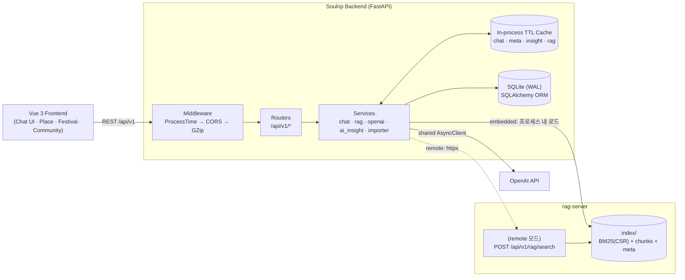

### Request Lifecycle

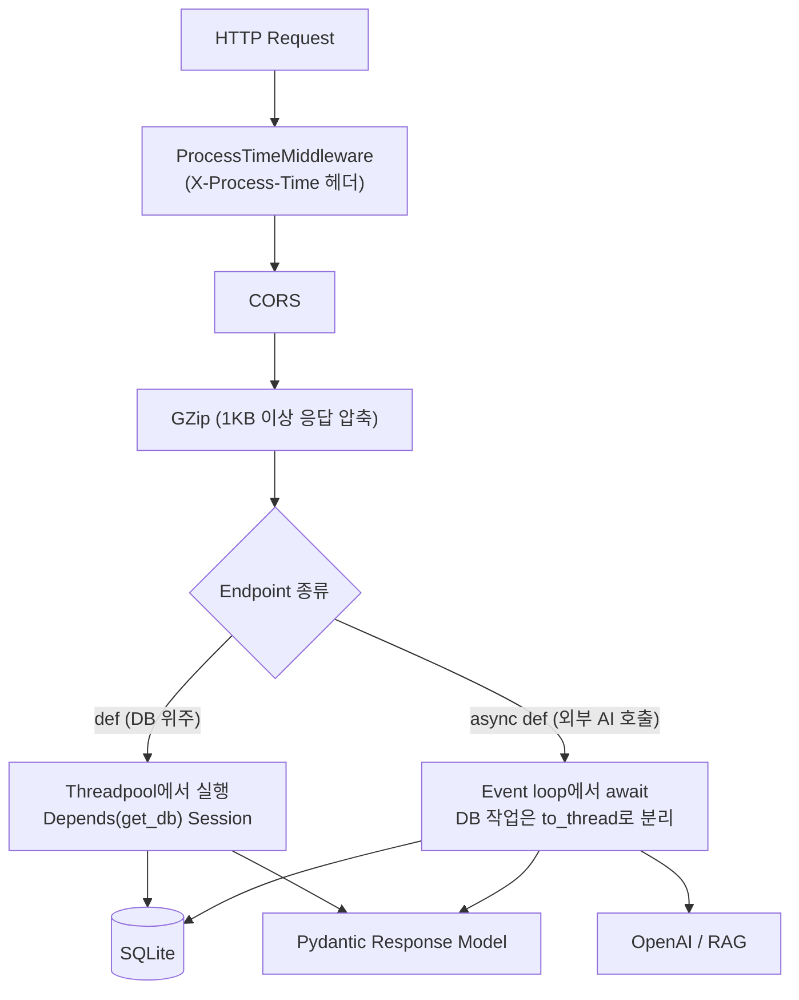

- **DB 중심 endpoint는 `def`로 유지**한다. 동기 SQLAlchemy를 `async def` 안에서 호출하면 이벤트 루프 전체가 멈추기 때문이다. FastAPI는 `def` endpoint를 스레드풀에서 실행한다.
- **외부 AI를 기다리는 endpoint(`/chat`, `/ai-insights`)만 `async def`** 로 바꾸고, 그 안의 DB 조회는 `anyio.to_thread`로 넘긴다.

### Startup (lifespan)

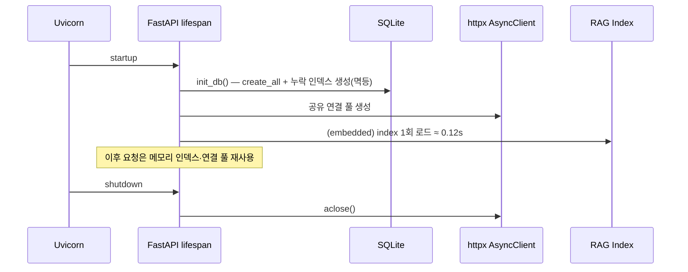

---

## Directory Structure

```text
soul-backend/
├─ app/
│  ├─ core/
│  │  ├─ config.py          # Settings(.env) — DB, AI, RAG, 캐시 TTL
│  │  ├─ cache.py           # 프로세스 메모리 LRU+TTL 캐시
│  │  ├─ http_client.py     # 외부 호출용 공유 httpx.AsyncClient
│  │  └─ middleware.py      # X-Process-Time 순수 ASGI 미들웨어
│  ├─ db/
│  │  ├─ database.py        # engine, SQLite PRAGMA, get_db, init_db
│  │  └─ models.py          # Location 중심 ORM 모델 + 복합 인덱스
│  ├─ routers/              # HTTP 입력·상태코드·예외 매핑
│  ├─ schemas/              # Pydantic 요청/응답 계약(camelCase)
│  ├─ services/
│  │  ├─ chat_service.py    # 챗봇: 기록 정규화 → 캐시 → DB·RAG 동시 검색 → OpenAI
│  │  ├─ rag_service.py     # RAG 검색(embedded/remote/off)
│  │  ├─ openai_client.py   # OpenAI 호출(동시성 제한)
│  │  ├─ ai_insight_service.py
│  │  ├─ importer.py        # 서울 관광 JSON → SQLite
│  │  ├─ recommendation.py  # haversine, 거리순 코스 정렬
│  │  └─ serializers.py
│  └─ main.py               # 앱 구성, lifespan, 미들웨어, Router 등록
├─ rag-server/              # RAG 데이터·인덱스·검색 서버 (자세한 내용: rag-server/README.md)
│  ├─ data/
│  │  ├─ manifest.json      # 원천 자료 메타데이터(연도·대상·확정/잠정·출처·색인 여부)
│  │  ├─ reports/           # 2024·2025 내/외국인 보고서, 2026 외국인 잠정치 PDF
│  │  ├─ statistics/        # 연도별 통계표 XLSX, 2019~2025 외국인 통합 통계표
│  │  ├─ places/            # 관광 명소·문화공간·문화행사 JSON, 자치구·관광지 분석 CSV
│  │  └─ raw/               # 응답자 원자료(색인 제외, git 제외)
│  ├─ rag/                  # loaders · text · index · retriever · embeddings · cache
│  ├─ scripts/build_index.py
│  ├─ index/                # 빌드 결과(약 4.3MB, 커밋 대상)
│  ├─ main.py               # (remote 모드) 검색 API 서버
│  └─ requirements.txt
├─ data/
│  ├─ festival_schedules.json  # 보완 데이터
│  └─ eval/chat_eval_set.json  # 챗봇 RAG 평가셋(v2, 65문항)
├─ scripts/
│  ├─ seed_data.py, check_data.py
│  └─ chat_eval/            # 챗봇 평가(LangSmith): check · sync · run · compare · chart · table
├─ docs/
│  ├─ frontend-rag-integration.md   # 프론트엔드 수정 가이드
│  ├─ rag-eval/                     # 평가 결과 JSON(v1·v2)과 그래프
│  └─ harness/                      # AI 하네스 문서
├─ CONTRIBUTING.md                  # 브랜치·커밋·PR 규칙
├─ render.yaml
├─ requirements.txt
└─ requirements-eval.txt            # 평가 전용 의존성(langsmith)
```

---

## Getting Started

### 1. Environment Variables

`.env.example`을 복사해 `.env`를 만든다. 비밀값은 커밋하지 않는다.

| 환경 변수 | 설명 | 예시 값 |
| --- | --- | --- |
| `DATABASE_URL` | DB 연결 주소 | `sqlite:///./soulrip.db` |
| `SQLITE_WAL` | SQLite WAL 모드 사용 | `true` |
| `CORS_ORIGINS` | 허용 프론트엔드 origin(쉼표 구분) | `http://localhost:5173` |
| `OPENAI_API_KEY` | 챗봇·AI Insight용 OpenAI 키(없으면 챗봇은 검색 결과 기반 fallback) | `sk-...` |
| `OPENAI_MODEL` | 챗봇·AI Insight 모델 | `gpt-4.1-mini` |
| `OPENAI_MAX_OUTPUT_TOKENS` | 챗봇 답변 최대 토큰 | `2048` |
| `OPENAI_MAX_CONCURRENCY` | OpenAI 동시 호출 상한 | `8` |
| `CHAT_CACHE_TTL_SECONDS` | 같은 질문·맥락 응답 재사용 시간 | `600` |
| `OPENAI_API_KEY` | AI Insight용 OpenAI 키(없으면 해당 API만 503) | `sk-...` |
| `OPENAI_MODEL` | AI Insight 모델 | `gpt-4.1-mini` |
| `AI_INSIGHT_CACHE_TTL_SECONDS` | 같은 날 인사이트 재사용 시간 | `600` |
| `RAG_MODE` | `embedded` / `remote` / `off` | `embedded` |
| `RAG_SERVER_URL` | remote 모드의 rag-server 주소 | `http://127.0.0.1:8001` |
| `RAG_API_KEY` | remote 모드 내부 호출 키(`X-RAG-Key`) | `change-me` |
| `RAG_TOP_K` / `RAG_MAX_CHARS_PER_HIT` | 질문당 RAG 근거 수 / 근거당 최대 글자 | `4` / `700` |
| `META_CACHE_TTL_SECONDS` | 카테고리·자치구 집계 캐시 | `300` |
| `ADMIN_KEY` | 축제 일정 관리 API 키(`X-Admin-Key`) | `change-me` |

### 2. Run Locally

```bash
# 1) 저장소 복제
git clone https://github.com/Soulrip-Trip/soul-backend.git
cd soul-backend

# 2) 가상환경 생성 및 활성화
python -m venv .venv
source .venv/Scripts/activate      # Windows Git Bash
# source .venv/bin/activate        # macOS / Linux

# 3) 의존성 설치
pip install -r requirements.txt

# 4) 환경 변수 파일 작성
cp .env.example .env

# 5) (서울 JSON 데이터가 준비된 경우) DB 시드
python -m scripts.seed_data

# 6) 서버 실행
uvicorn app.main:app --reload
```

`rag-server/index/`가 저장소에 포함되어 있으므로 별도 빌드 없이 `RAG_MODE=embedded`로 바로 RAG가 동작한다. 기동 로그 또는 `GET /api/v1/health`의 `rag` 값이 `embedded:ready(7944 chunks)`이면 정상이다.

### 3. (원천 자료를 바꿨을 때만) RAG 인덱스 다시 빌드

```bash
cd rag-server
pip install -r requirements.txt
python -m scripts.build_index          # BM25 인덱스(외부 API 호출 없음, 약 1분)
# python -m scripts.build_index --embed  # (선택) Gemini 임베딩 하이브리드
```

### 4. (선택) RAG를 별도 서버로 분리 — remote 모드

```bash
# 터미널 1: rag-server
cd rag-server && RAG_API_KEY=change-me uvicorn main:app --port 8001

# 터미널 2: backend (.env)
RAG_MODE=remote
RAG_SERVER_URL=http://127.0.0.1:8001
RAG_API_KEY=change-me
```

---

## API Documentation

FastAPI가 OpenAPI 문서를 자동 생성한다. 서버 실행 후 접속한다.

| 문서 | URL | 용도 |
| --- | --- | --- |
| **Swagger UI** | http://127.0.0.1:8000/docs | 대화형 API 테스트 |
| **ReDoc** | http://127.0.0.1:8000/redoc | 가독성 높은 문서 뷰어 |
| OpenAPI JSON | http://127.0.0.1:8000/openapi.json | 스키마 원본 |
| RAG Server Swagger | http://127.0.0.1:8001/docs | remote 모드 검색 API |
| Production | https://soulrip-backend.onrender.com/api/v1 | 배포 API |

### Endpoint Overview

기본 prefix는 `/api/v1`이다. 응답 필드는 camelCase다.

```http
GET    /places                      ?q&contentType&district&hasImage&featured&sort&page&size
GET    /places/map                  ?contentType&district&q&limit
GET    /places/nearby               ?latitude&longitude&radiusKm&limit&contentType
GET    /places/{contentId}

GET    /festivals                   ?month&year&q&district&page&size
GET    /festivals/calendar          ?year&month
GET    /festivals/on-date           ?date=YYYY-MM-DD
GET    /festivals/{contentId}
POST   /festivals/{contentId}/schedules       (X-Admin-Key)
DELETE /festivals/schedules/{scheduleId}      (X-Admin-Key)

GET    /courses                     ?q&district&page&size
GET    /courses/{contentId}
POST   /courses/recommend

GET    /posts                       ?q&type&sort&page&limit
POST   /posts
GET    /posts/{id}
PATCH  /posts/{id}
DELETE /posts/{id}?password=...
POST   /posts/{id}/verify-password
POST   /posts/{id}/likes
GET    /posts/{id}/likes/status?clientId=...
GET    /posts/{id}/comments
POST   /posts/{id}/comments
PATCH  /posts/comments/{commentId}
DELETE /posts/comments/{commentId}?password=...

GET    /travel-records?clientId=...
POST   /travel-records
GET    /travel-records/{id}?clientId=...
PATCH  /travel-records/{id}
DELETE /travel-records/{id}?clientId=...

POST   /chat
GET    /insights/today
POST   /ai-insights/today

GET    /meta/categories
GET    /meta/districts
GET    /meta/stats
GET    /health
```

### Status Code Policy

| 상황 | 상태코드 |
| --- | --- |
| 리소스 없음 / 다른 `clientId`의 비공개 기록 | 404 |
| 사용자 입력 오류(종료일 < 시작일, 없는 장소 contentId) | 400 / 422 |
| 비밀번호·관리자 키 불일치 | 403 |
| 서버 설정 누락(OPENAI 키), 인사이트용 데이터 없음, 외부 AI 연결 실패 | 503 |
| 외부 AI 응답 형식 오류·상태 오류 | 502 |
| 외부 AI 요청 한도 초과 | 429 |
| 챗봇의 OpenAI·RAG 실패 | **200 + fallback 응답** (`usedAi: false`) |

---

## AI Chatbot & RAG

### Chat Flow

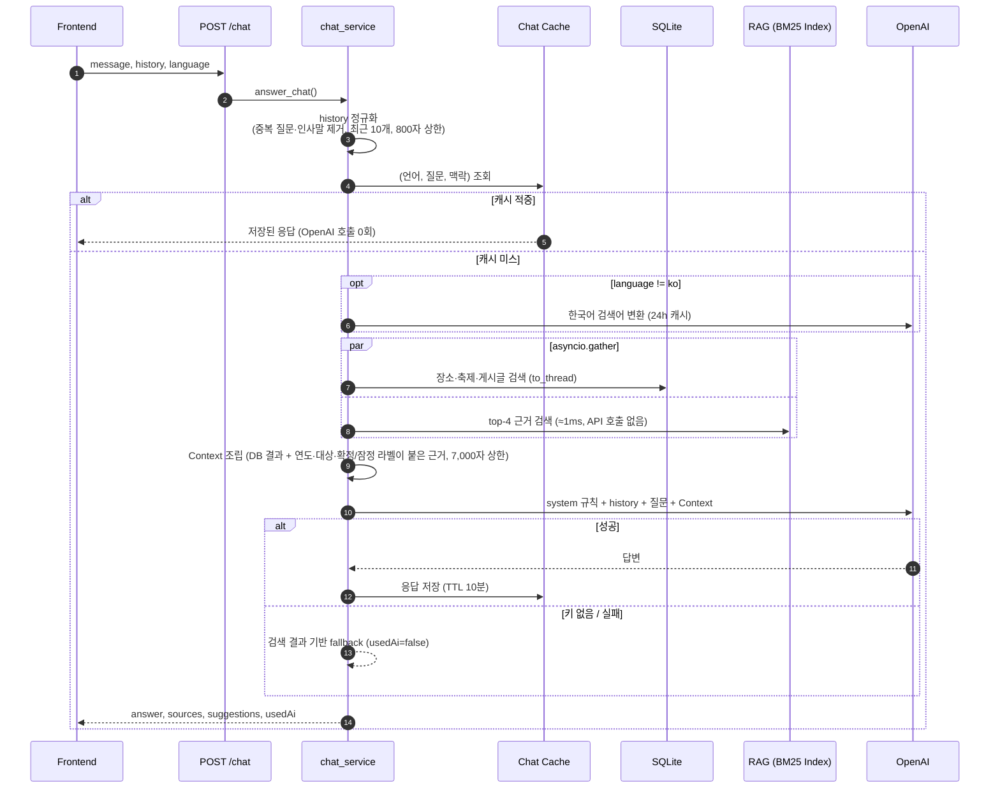

### RAG Index Build Pipeline (오프라인 1회)

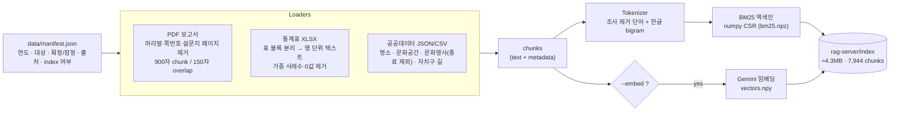

### Retrieval Strategy

| 단계 | 내용 | 이유 |
| --- | --- | --- |
| 질의 분석 | 연도(2019~2026, 올해/작년), 월(이번 달/11월), 대상(외국인/내국인), 의도(실태조사/장소/행사/조사방법) 추출 | 메타데이터를 검색 가중치로 사용 |
| 질의 확장 | 소비→지출·비용, 특징→특성, 혼행→혼자·동행인 등(가중치 0.5) | 보고서 용어와 사용자 표현 차이 보정 |
| BM25 | 로컬 역색인 점수 | 외부 API·토큰 비용 0 |
| 메타데이터 가중치 | 연도 일치 ×1.5 / 다른 연도 ×0.5, 대상 일치 ×1.25, 연도 미지정 시 최신 확정치 우선·잠정치 ×0.85, 조사개요 페이지 ×0.6 | 2024·2025 수치 혼동, 잠정치 과신 방지 |
| 필터 | 종료된 문화행사 제외, 질문한 달과 겹치는 행사 ×1.6 | 지난 행사 추천 방지 |
| 다양성 | 문서당 최대 2개, 여러 연도 비교 시 연도별 균등 배분 | "2024 vs 2025" 질문에 한쪽 연도만 나오는 문제 해결 |
| (선택) Dense | Gemini 임베딩 코사인 + BM25를 RRF로 융합 | 의미 유사 질의 보강(remote 모드) |

### Hybrid: 무엇을 RAG로, 무엇을 DB로

| 데이터 | 처리 방식 | 위치 |
| --- | --- | --- |
| 2024·2025 내/외국인 실태조사 보고서, 2026 외국인 잠정치 | PDF RAG | `rag-server/data/reports` |
| 연도별 통계표, 2019~2025 외국인 통합 통계표 | 표 → 텍스트 RAG | `rag-server/data/statistics` |
| 서울시 관광 명소·문화공간·문화행사, 자치구 길·특화거리 | 공공데이터 RAG | `rag-server/data/places` |
| 장소·축제·코스·게시글(서비스 원본) | SQLite 검색 | `soulrip.db` |
| 응답자 원자료(SAV/XLSX), 설문지, 코드북 | **색인 제외**(manifest에 사유 기록) | `rag-server/data/raw` 등 |
| 실시간 혼잡도·교통 | (향후) 실시간 API — 연도별 기록으로 간주하지 않음 | — |

### Token Saving Strategy

| 전략 | 효과 |
| --- | --- |
| 인덱스를 **오프라인에서 1회 빌드**, 서버는 기동 시 1회 로드 | 요청마다 PDF·XLSX를 다시 읽거나 임베딩하지 않음 |
| 전체 자료(약 673만 자) 대신 **top-4 × 최대 700자**만 전달 | 근거 전달량이 전체의 약 0.04% |
| 로컬 BM25 검색 | 검색 단계의 외부 API 호출·토큰 0 |
| 응답 캐시(언어·질문·맥락, TTL 10분) | 추천 질문 버튼처럼 반복되는 질문은 OpenAI 재호출 없음 |
| 대화 기록 정규화 | 프론트가 함께 보내던 **현재 질문 중복**과 인사말 제거, 최근 10개·메시지당 800자 |
| Context 7,000자 상한, `maxOutputTokens` 설정 | 요청·응답 토큰 상한 고정 |
| 번역 검색어 캐시(24h), 질의 임베딩 캐시 | 비한국어·dense 검색의 반복 호출 방지 |

---

## RAG Evaluation

지역 정보 챗봇이 **사용자의 조건(지역·유형)을 지키고, 저장된 데이터에 근거해서만 답하는지**를 "느낌"이 아니라 수치로 검증한다. 서비스 런타임과 분리된 개발용 도구이며 `scripts/chat_eval/`에 있다. 실험은 LangSmith에 기록해 질문별 trace와 전후 비교를 웹에서 볼 수 있다.

### 진행 방식

```text
① 평가셋 작성          65문항, 정답은 soulrip.db 실데이터 기준                         ✅ 완료
② baseline 측정        원래 코드로 dev 43문항 · holdout 22문항 실행 → LangSmith          ✅ 완료
③ 실패 사례 분석       조건 누락 · 근거 없는 답변을 질문 단위로 확인                     ✅ 완료
④ 검색·프롬프트 개선    원인 8개 중 7개를 일반 원칙으로 수정                              ✅ 완료
⑤ RAG·성능 개선 병합    별도 브랜치를 병합하고 챗봇을 OpenAI로 통일                       ✅ 완료
⑥ 3단계 재측정          같은 평가셋(v2)으로 ①원래 ②병합 전 개선 ③병합 후를 dev·holdout 측정  ✅ 완료
```

**한 줄 결과** — 원래 코드(①) 대비 병합 후(③) dev 기준 검색 조건 충족률 **44.2% → 95.0%**, 검색 적중률 **76.2% → 90.5%**, 답변 정확도 **79.1% → 90.7%**, 근거 충실도 **83.7% → 97.7%**, 근거 없는 날짜 **93.0% → 100%**. holdout에서는 조건 충족률 26.6% → 100%, 정확도 77.3% → 86.4%였다. **다만 병합 후(③)가 병합 전 개선(②)보다 나아진 것은 아니다.** 검색 지표는 같고 holdout 정확도는 95.5% → 86.4%로 내려갔으며(2문항), LLM 채점 지표는 같은 코드를 다시 측정해도 5~9p 흔들렸다([7절 해석](#결과-해석)). 계획형 시간표 질문 등 남은 문제는 [8절](#8-남은-문제)에 적었다.

개선에 쓰는 질문(`dev`)과 최종 검증용 질문(`holdout`)을 분리했다. 같은 질문을 보며 프롬프트를 고치면 그 질문에만 최적화될 수 있기 때문이다.

### 1. 평가셋 설계

`data/eval/chat_eval_set.json` — 65문항. **정답은 `soulrip.db`의 실제 데이터**로 작성했다(content_id, 지역·유형 조건, 전화번호 등). 이 DB에는 입장료·운영시간·행사 일정·장소 설명이 없으므로, 그런 정보를 물으면 **"모른다"고 답하는 것이 정답**인 질문을 일부러 넣었다. 질문마다 페르소나와 프롬프트 스타일을 붙여 어떤 사용자·어떤 입력 형태에서 약한지 나눠 볼 수 있다.

**프롬프트 스타일 4종**

| 스타일 | 문항 | 실제 질문 예 |
| --- | ---: | --- |
| `short` 키워드 | 12 | `마포구 레포츠` |
| `medium` 한 문장 | 33 | `혼자 가도 부담 없는 종로구 문화시설 알려줘` |
| `long` 상황 서술 | 12 | `이번 주말에 혼자 조용히 쉬고 싶어서 강남구에 있는 문화시설을 찾고 있어요. 사람 너무 많은 곳은 피하고 싶고, 혼자 둘러보기 좋은 곳이면 좋겠어요. 몇 군데 알려주세요.` |
| `structured` 계획형 | 8 | `[지역] 용산구 / [유형] 관광지 / [인원] 1명 / [요청] 3곳 추천 + 각 장소의 주소 / [주의] 데이터에 없는 영업시간, 입장료는 쓰지 말 것` (실제 입력은 항목별 줄바꿈) |

**페르소나 18종 — 혼행자 54문항(83%), 그 외 11문항**

| 그룹 | 페르소나 (문항 수) |
| --- | --- |
| 혼행 · 내국인 (40) | 첫 혼행 7, 계획형 7, 대학생 6, 즉흥형 5, 직장인 5, 혼밥 4, 사진 3, 시니어 3 |
| 혼행 · 외국인 (14) | 영어 7, 일본어 3, 중국어 1, 프랑스어 1, 스페인어 1, 독일어 1 |
| 그 외 (11) | 커플 7, 친구 2, 부모님 동반 1, 서울 거주자 1 |

**질문 카테고리 11종**

| 카테고리 | 문항 | 확인하려는 것 |
| --- | ---: | --- |
| `district_category` | 15 | "종로구 문화시설"처럼 지역·유형 조건을 지키는가 |
| `place_lookup` | 11 | 특정 장소의 위치를 데이터대로 답하는가 |
| `attribute_unavailable` | 10 | 가격·시간·시설처럼 데이터에 없는 정보를 지어내지 않는가 |
| `festival_date` / `festival_info` | 6 / 2 | 데이터에 없는 행사 날짜를 말하지 않고, 있는 전화번호는 알려주는가 |
| `recommend_open` | 6 | 열린 추천에서 "조용하다·혼자 가기 좋다" 같은 근거 없는 수식어를 붙이지 않는가 |
| `course` / `community` | 4 / 3 | 코스 경유지·후기를 지어내지 않는가 |
| `followup` | 4 | 이전 대화의 지역·조건을 이어받는가 |
| `no_data` / `out_of_scope` | 2 / 2 | 음식점(데이터 없음)·타 지역·날씨 질문에 맛집/정보를 지어내지 않는가 |

언어는 ko 51, en 7, ja 3, zh·fr·es·de 각 1문항이다. 평가셋은 현재 DB 스냅샷에 묶여 있으므로 DB를 다시 시드했다면 `python -m scripts.chat_eval check`로 정답이 유효한지 먼저 확인한다.

### 2. 지표

| 지표 | 방식 | 의미 |
| --- | --- | --- |
| `source_hit` 검색 적중률 | 결정적 | 기대한 장소·게시글이 `sources`에 들어왔는가 |
| `source_condition_rate` 검색 조건 충족률 | 결정적 | `sources` 중 질문의 지역·유형 조건을 만족하는 비율 |
| `answer_correctness` 답변 정확도 | LLM judge | 정답 기준(criteria)을 만족하는가. 정보 없음 질문은 "모른다"고 답해야 통과 |
| `faithfulness` 근거 충실도 | LLM judge | 답변의 모든 주장이 검색 컨텍스트에 근거하는가 |
| `answer_condition` 답변 조건 충족률 | LLM judge | 답변이 제시한 장소가 질문의 조건을 만족하는가 |
| `no_unsupported_date` | 결정적 | 답변의 날짜가 `FestivalSchedule` 또는 질문에 근거하는가. 검색 컨텍스트에 날짜가 있어도 `modifiedtime`은 일정으로 인정하지 않는다 |
| `no_unsupported_price_hours` | 결정적 | 답변의 금액·시각·휴무 표현이 컨텍스트 또는 질문에 있는가 |
| `must_include` / `language_match` | 결정적 | 필수 키워드(예: 전화번호) 포함 / 요청 언어로 답했는가 |
| `used_ai` | 결정적 | OpenAI 호출 성공 여부. 0이면 fallback 답변이므로 해당 질문은 답변 지표에서 제외 |

결정적 지표는 코드로 계산해 재현된다. LLM judge는 질문당 1회 호출해 정확도·충실도·조건 충족을 함께 0/1로 채점한다. 결과는 카테고리, 프롬프트 스타일, 여행자 유형, 페르소나, 언어별로 나눠 집계한다.

### 3. 실행 방법

```bash
pip install -r requirements-eval.txt        # 평가 전용 의존성 (서비스 배포에는 포함되지 않음)
python -m scripts.chat_eval check           # 평가셋 형식 · DB 정답 검증

# LangSmith에 평가셋을 올리고 전체 평가를 기록
python -m scripts.chat_eval sync
python -m scripts.chat_eval run --tag baseline          # dev 43문항
python -m scripts.chat_eval run --tag prompt-v2         # 수정 후 같은 dev로 재측정
python -m scripts.chat_eval run --split holdout --tag final   # 개선을 마친 뒤 1회

# 업로드 없이 로컬에서만 / LLM 호출 없이 검색 지표만
python -m scripts.chat_eval run --local --tag baseline
python -m scripts.chat_eval run --local --retrieval-only --split all --tag baseline

# 결과 활용
python -m scripts.chat_eval compare <before> <after>             # 지표별 증감 + 오히려 나빠진 질문 목록
python -m scripts.chat_eval chart <before> <after> --out docs/rag-eval/after-overall.svg   # 전후 막대그래프
python -m scripts.chat_eval table <결과> --by category            # README용 마크다운 표
```

필요한 환경변수는 `OPENAI_API_KEY`(챗봇과 judge)와 `LANGSMITH_API_KEY`(업로드)이다. 각 실험 metadata에는 git commit, `app/` 변경 여부, 시스템 프롬프트 해시, 챗봇·judge 모델이 기록된다. LangSmith에서는 Datasets & Experiments → `soulrip-chatbot-eval` → Experiments 탭에서 실험을 선택해 질문별 trace와 비교 화면을 볼 수 있다.

### 4. 개선 전(baseline) 실패 사례 분석

baseline 첫 측정(평가셋 v1, dev)에서 만점이 아니었던 질문 23개를 질문 단위로 확인했다(원본 답변과 채점 사유는 결과 JSON에 있다). 원인에 "코드 확인"이라고 적은 항목은 코드를 직접 읽고 해당 질문의 검색어·컨텍스트를 재현해 확인한 것이고, "가설"은 검증하지 않은 추정이다.

| # | 문제 | 근거 (baseline 실측) | 원인 |
| --- | --- | --- | --- |
| 1 | **행사 날짜 환각** | `no_unsupported_date` 실패 3건, `festival_date` 정확도 25%. 답변에 `축제일 2025-10-23`, `6월 5일`, `2026-05-06` 같은 날짜가 등장 | 코드 확인: `_search_context`가 `FestivalSchedule`이 없는 축제의 컨텍스트에 `source_modified_at`을 `축제일`로 넣는다. 원본 `modifiedtime`은 행사 일정이 아니다(Festivals 불변조건 위반) |
| 2 | **지역·유형 조건 누락(검색)** | `source_condition_rate` 45.0%. 예: `마포구에 커플이 묵을 만한 숙박시설` → 검색된 8곳 중 조건에 맞는 곳은 1곳 | 코드 확인: 검색어 중 하나라도 맞으면 후보에 넣는 OR 조건이고, 후보를 수정일 순 상위 100개로 자른 뒤에야 일치 개수로 정렬한다 |
| 3 | **영어·독일어 질문의 검색 품질** | 검색 조건 충족률 en 6%(n=2), de 25%(n=1) | 가설: 번역된 검색어가 지역 조건을 살리지 못함. 표본이 작아 확정하기 어려움 |
| 4 | **이전 대화 조건 유실** | `followup` 검색 조건 충족률 0%. `그럼 거기서 가까운 숙박도 알려줘` → 검색 결과 0건 | 코드 확인: 검색은 현재 메시지만 사용하고 history는 LLM 호출에만 전달한다 |
| 5 | **근거 없는 수식어** | `recommend_open` 정확도 0%(0/3), `long` 정확도 56%. 예: `이곳들은 상대적으로 조용히 혼자 관람하기 좋을 것으로 보입니다` | 프롬프트가 "영업시간·가격·축제 날짜"만 금지하고 장소의 분위기·적합성 단정은 막지 않는다 |
| 6 | **계획형 입력에서 시간표 날조** | `structured` 정확도 43%, 충실도 71%. 1일 코스 요청에 `10:00~12:00 …` 시간표를 채움 | 시간표 형식 요청에 응하다 데이터에 없는 시각을 만듦 |
| 7 | **긴 질문에서 핵심 장소명이 검색어에서 잘림** | `long` 검색 적중률 50%. `창덕궁 달빛기행` 문의는 검색 0건이라 데이터에 있는 전화번호(1522-2295)를 "없다"고 답함. `경복궁→북촌한옥마을→광장시장` 질문도 0/3 | 코드 확인: `_search_terms`가 질문의 **앞 8단어만** 검색어로 쓴다. 추출된 검색어가 `다음, 달에, 남자친구랑, 야간, …`이어서 `창덕궁`, `달빛기행`이 빠졌다 |
| 8 | **유형 표현이 DB의 유형명과 어긋남** | 위 2번 예시의 `숙박시설` 검색 | 코드 확인: 유형 매칭이 `content_type ILIKE '%숙박시설%'`인데 DB 값은 `숙박`이라 매칭되지 않는다. 대신 `커플`이 `슈마커플러스` 같은 상호에 걸렸다 |

**잘 동작한 것**: 입장료·운영시간처럼 데이터에 없는 정보를 물으면 지어내지 않고 모른다고 답했다(`attribute_unavailable` 정확도 7/7). 장소 조회 7/7, 커뮤니티·코스 질문 5/5, 요청 언어 일치 43/43이었다. 개선 후에도 이 항목들이 유지되는지 함께 확인했다.

**프롬프트만으로 해결되는 문제(5, 6)와 검색·코드 수정이 필요한 문제(1, 2, 4, 7, 8)가 섞여 있다.** 조건 충족률 45%는 프롬프트를 다듬어도 오르지 않는 구간이라, 검색 단계를 먼저 고쳤다.

### 5. 무엇을 어떻게 바꿨나

**검색·프롬프트 개선**은 `app/services/chat_service.py`에서 했다. **API 요청·응답 필드(`answer`, `sources`, `suggestions`, `usedAi`), `/api/v1/chat` 경로, OpenAI 실패 시 fallback은 그대로**이다. 특정 평가 질문에 맞춘 규칙은 넣지 않고, 위 원인에 대응하는 일반 원칙으로만 고쳤다.

| 해결한 문제 | 변경 전 | 변경 후 |
| --- | --- | --- |
| **#7 긴 질문에서 장소명 잘림** | 질문의 앞 8단어를 검색어로 사용 | 질문에서 단어를 모두 뽑은 뒤 **DB에 실제로 있는 단어만** 검색어로 사용(단어별 일치 장소 수를 query 1회로 집계). 600개를 넘는 장소에 걸리는 흔한 단어는 제외 |
| **#2, #8 지역·유형 조건 누락** | 모든 검색어를 OR로 합친 뒤 수정일순 상위 100개만 정렬 | 질문에서 **자치구·유형을 추출**해 필터로 먼저 적용(`숙박시설`·`호텔`→숙박, `행사`·`공연`→축제공연행사 등). 필터 안에서 검색어로 좁히고, 결과가 없으면 필터만, 그래도 없으면 기존 방식으로 완화한다. 후보 한도는 400개 |
| **순위 매기기** | 일치한 단어 개수가 같으면 수정일순 | 드문 단어에 일치할수록, 제목과 사실상 같은 장소명일수록 앞에 둔다(역빈도 가중치) |
| **#4 이전 대화 조건 유실** | 검색은 현재 메시지만 사용 | 현재 메시지에 지역도 장소명도 없고 지시어("거기", "그 근처")뿐이면 **이전 대화의 지역을 이어받는다**. 영문 자치구 표기도 인식 |
| **#1 행사 날짜 환각** | 컨텍스트에 `축제일: {source_modified_at}` 노출 | 수정 시각을 컨텍스트에서 제거. `FestivalSchedule`이 있으면 `일정: 시작~종료`, 없으면 `일정: 저장된 데이터에 없음`으로 표기 |
| 커뮤니티 글 보장 | 장소 8개가 차면 `sources[:8]`에 밀려 글 카드가 사라짐 | 2개 이상 단어가 일치한 글에 최대 2자리를 보장. 카드와 LLM 컨텍스트가 같은 목록을 쓰도록 맞춤 |
| **#5, #6 수식어·시간표 날조** (프롬프트) | "영업시간·가격·축제 날짜를 추측하지 않는다" | 규칙 6개로 구체화: 조건에 맞는 장소만 제시 / 일정·시각·가격·이동시간은 없으면 "정보 없음"(시간표 요청에도 시각을 만들지 않음) / 분위기·혼자 가기 좋음·조용함 같은 특성 단정 금지 / 문의 전화번호는 그대로 안내 |

<details>
<summary>시스템 프롬프트 전문 (Before / After)</summary>

**Before** (해시 `092705f8`)

```text
너는 Soulrip 서울 여행 도우미다. 반드시 제공된 데이터 문맥만 근거로 답하고, 문맥에 없는 영업시간·가격·축제 날짜를 추측하지 않는다. 검색 결과가 없으면 모른다고 답한다. 답변에 사용한 장소명은 제공된 표기를 그대로 쓴다. Answer concisely in {language}.
```

**After — 병합 전 개선** (해시 `48018a31`)

```text
너는 Soulrip 서울 여행 도우미다. 반드시 제공된 데이터 문맥만 근거로 답한다. 규칙은 다음과 같다.
1) 사용자가 말한 지역·유형 조건에 맞는 장소만 제시하고, 조건에 맞는 장소가 문맥에 없으면 없다고 답한다.
2) 영업시간·가격·입장료·행사 일정·날짜·소요 시간·이동 시간·예약 방법·시설 정보가 문맥에 없으면 추측하지 말고 '저장된 데이터에 정보가 없다'고 답한다. 시간표나 표를 요청받아도 문맥에 없는 시각과 날짜는 만들지 않고 '정보 없음'으로 적는다.
3) 장소의 분위기·혼자 가기 좋음·조용함·안전·접근성·사진 명소 같은 특성은 문맥에 없으면 말하지 않는다. 장소는 이름·유형·주소처럼 제공된 정보로만 소개한다.
4) 문맥에 문의 전화번호가 있으면 그대로 알려준다.
5) 검색 결과가 없으면 모른다고 답한다.
6) 답변에 사용한 장소명은 제공된 표기를 그대로 쓴다.
Answer concisely in {language}.
```

</details>

**RAG·성능 개선 병합과 OpenAI 통일** — 별도로 진행된 `feat/rag-backend-optimization`(서울관광 실태조사·서울시 공공데이터 RAG 인덱스, 비동기 챗봇, 응답 캐시, 목록 N+1 제거, SQLite WAL 등)을 병합했다. 두 작업의 `chat_service.py`가 겹쳤고 저쪽 챗봇은 Gemini를 호출했기 때문에 다음과 같이 합쳤다.

| 항목 | 병합 방식 |
| --- | --- |
| 챗봇 구조 | 저쪽의 비동기 구조(기록 정규화 → 응답 캐시 → DB·RAG 동시 검색)를 그대로 유지 |
| 모델 | `gemini_client`를 같은 인터페이스의 `openai_client`로 교체하고 `GEMINI_*` 설정을 `OPENAI_*`로 바꿨다. Render·`.env.example`·문서도 OpenAI 기준으로 통일 |
| 검색 | 위 검색 개선(조건 필터, DB 단어 검색어, 역빈도 순위, 이전 대화 지역 승계)을 저쪽 구조 안으로 이식. 저쪽이 독립적으로 고친 축제 일정(`FestivalSchedule`만 사용)과 일치 |
| 프롬프트 | 저쪽의 RAG 규칙(연도·조사 대상 표기, 잠정치 명시, 수치 합산 금지)과 위 규칙 1~6을 하나로 통합. 통합하면서 "다음 달·이번 주말 같은 상대 표현을 실제 연월일로 바꿔 말하지 않는다"와 "실태조사의 평균 지출을 특정 장소의 입장료처럼 제시하지 않는다"를 추가 (해시 `cc4231d7`) |
| 평가 하네스 | 비동기 챗봇에 맞추고, RAG 행사 근거에 적힌 날짜는 근거 있는 날짜로 인정 |

비용 측면에서 검색 1회당 DB query가 기존 2~3회에서 평균 3.5회(한국어 51문항 기준)로 늘었다(단어 빈도 집계 1회, 축제 일정 조회 1회). 응답 시간은 따로 측정하지 않았다.

### 6. 평가셋 v2 — RAG 도입으로 바뀐 정답 기준

RAG를 병합하자 일부 지표가 직전 버전보다 내려갔다(dev 정확도 −7.0p). 원인을 확인해 보니 **챗봇이 나빠진 것이 아니라 평가셋의 정답이 낡은 것**이 대부분이었다. 서울시 공공데이터(RAG `place`·`event` 컬렉션)에는 실제 운영시간·입장료·휴무일·행사 기간이 들어 있다.

| 질문 | RAG 근거에 실제로 있는 값 | 기존 정답 기준 |
| --- | --- | --- |
| `남산타워 몇 시까지?` | 남산서울타워 평일 10:00-22:30, 주말 10:00~23:00 | "데이터에 없으므로 시각을 말하면 안 된다" |
| `전쟁기념관 …` | 09:30~17:40, 월요일 휴무 | 운영시간을 말하면 안 된다 |
| `국립중앙박물관 운영시간·무료 여부` | 관람료 0(무료), 옥외 전시장 오전 7시~오후 10시 | 시간·무료 여부를 말하면 안 된다 |
| `경복궁 입장료` | 행사 근거에 "경복궁 입장료 별도, 유료"(금액은 없음) | 입장료는 데이터에 없다 |

그래서 이런 **20개 질문의 정답 기준**을 "검색 컨텍스트에 있으면 그대로 전하고, 없으면 모른다고 답한다. 컨텍스트에 없는 값을 지어내면 실패"로 바꿨다(평가셋 v2). 서비스 불변조건(데이터에 없는 사실을 추측하지 않는다)과 같은 원칙이며, 오히려 더 엄격하다. 예를 들어 실태조사의 평균 지출 `63,000원`을 경복궁 입장료처럼 말하면 여전히 실패다. LLM judge에는 컨텍스트에서 값을 직접 확인해 판단하도록 지시를 추가했다.

결과를 본 뒤에 기준을 고치는 것이므로 다음과 같이 공정성을 확보했다.

- **v1 원본과 v1 기준 측정 결과를 그대로 보관**했다([`docs/rag-eval/v1/`](docs/rag-eval/v1)). v1 기준으로 처음 측정한 baseline의 답변 정확도는 72.1%(재측정 74.4%), 개선 직후는 93.0%였다.
- **세 단계를 모두 v2로 다시 측정**했다. 특히 원래 baseline 코드는 worktree에 복원해 같은 조건으로 돌렸다. 복원이 정확한지 시스템 프롬프트 해시(`092705f8`)와 검색 지표가 첫 baseline과 일치하는지로 확인했다.
- 바꾼 20개는 모두 "정보가 없다"가 정답이던 질문(운영시간·가격·일정·휴무 등)이며, 정답 질문의 위치·전화번호·조건 기준은 건드리지 않았다. 변경 이유와 질문 id는 평가셋 `meta.changelog`에 있다.
- 컨텍스트에 값이 없는데 지어내는 경우(예: `다음 달(2024년 7월)`)는 v2에서도 그대로 실패로 잡힌다.

### 7. 단계별 비교 결과 (2026-10-26, 평가셋 v2, 실측)

| 단계 | 코드 | 시스템 프롬프트 | dev 실험 | holdout 실험 |
| --- | --- | --- | --- | --- |
| ① baseline | 원래 검색·프롬프트 (`bc9f81b` 로직, OpenAI 호출) | `092705f8` | `baseline-v2-dev-full-56cdf977` | `baseline-v2-holdout-full-2f63f348` |
| ② 병합 전 개선 | 검색·프롬프트 개선 (`062cef5`) | `48018a31` | `improved-v2-dev-full-995ef352` | `improved-v2-holdout-full-bf53dc82` |
| ③ 병합 후 | RAG·성능 병합 + OpenAI 통일 (현재) | `cc4231d7` | `merged-v2-dev-full-899860c1` | `merged-v2-holdout-full-3d25d63c` |

챗봇·judge는 모두 `gpt-4.1-mini`이고 원본 결과는 [`docs/rag-eval/v2/`](docs/rag-eval/v2)에 있다. 그래프는 `python -m scripts.chat_eval chart`로 그렸다.

#### 전체 지표 — dev 43문항

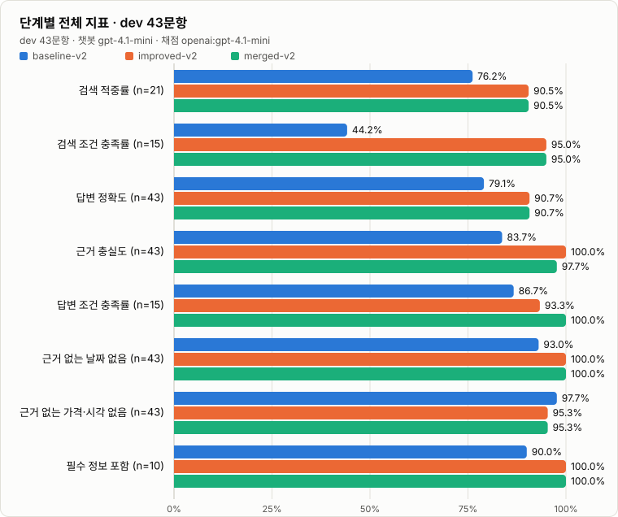

| 지표 | ① baseline | ② 병합 전 개선 | ③ 병합 후 (RAG) | ①→③ | 적용 문항 |
| --- | ---: | ---: | ---: | ---: | ---: |
| 검색 적중률 (`source_hit`) | 76.2% | 90.5% | **90.5%** | +14.3p | 21 |
| 검색 조건 충족률 (`source_condition_rate`) | 44.2% | 95.0% | **95.0%** | +50.8p | 15 |
| 답변 정확도 (`answer_correctness`) | 79.1% | 90.7% | **90.7%** | +11.6p | 43 |
| 근거 충실도 (`faithfulness`) | 83.7% | 100.0% | **97.7%** | +14.0p | 43 |
| 답변 조건 충족률 (`answer_condition`) | 86.7% | 93.3% | **100.0%** | +13.3p | 15 |
| 근거 없는 날짜 없음 (`no_unsupported_date`) | 93.0% | 100.0% | **100.0%** | +7.0p | 43 |
| 근거 없는 가격·시각 없음 (`no_unsupported_price_hours`) | 97.7% | 95.3% | **95.3%** | -2.3p | 43 |
| 필수 정보 포함 (`must_include`) | 90.0% | 100.0% | **100.0%** | +10.0p | 10 |

#### 개선에 쓰지 않은 holdout 22문항

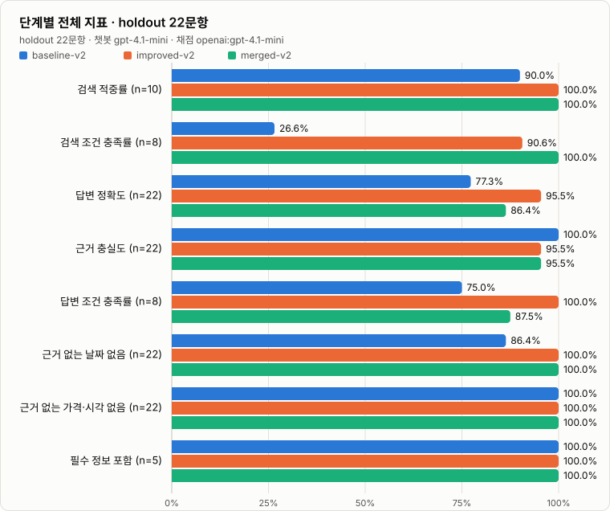

| 지표 | ① baseline | ② 병합 전 개선 | ③ 병합 후 (RAG) | ①→③ | 적용 문항 |
| --- | ---: | ---: | ---: | ---: | ---: |
| 검색 적중률 (`source_hit`) | 90.0% | 100.0% | **100.0%** | +10.0p | 10 |
| 검색 조건 충족률 (`source_condition_rate`) | 26.6% | 90.6% | **100.0%** | +73.4p | 8 |
| 답변 정확도 (`answer_correctness`) | 77.3% | 95.5% | **86.4%** | +9.1p | 22 |
| 근거 충실도 (`faithfulness`) | 100.0% | 95.5% | **95.5%** | -4.5p | 22 |
| 답변 조건 충족률 (`answer_condition`) | 75.0% | 100.0% | **87.5%** | +12.5p | 8 |
| 근거 없는 날짜 없음 (`no_unsupported_date`) | 86.4% | 100.0% | **100.0%** | +13.6p | 22 |
| 근거 없는 가격·시각 없음 (`no_unsupported_price_hours`) | 100.0% | 100.0% | **100.0%** | +0.0p | 22 |
| 필수 정보 포함 (`must_include`) | 100.0% | 100.0% | **100.0%** | +0.0p | 5 |

#### 프롬프트 스타일별 (dev, ①→③) — 길고 복잡한 입력에서 가장 크게 좋아졌다

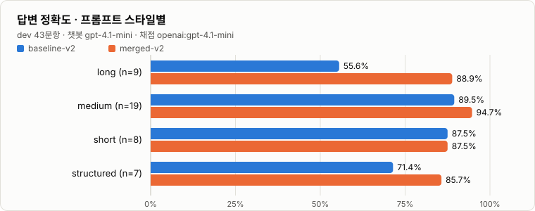

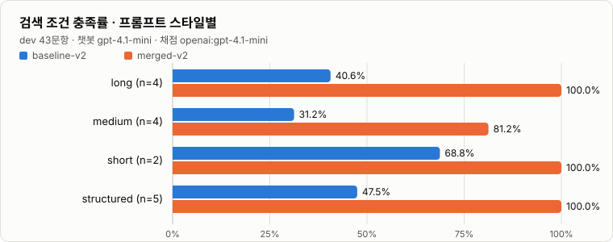

| prompt_style | 문항 | 검색 조건 충족률 | 답변 정확도 | 근거 충실도 |
| --- | ---: | ---: | ---: | ---: |
| long | 9 | 41% → **100%** (4) | 56% → **89%** (9) | 67% → **100%** (9) |
| medium | 19 | 31% → **81%** (4) | 89% → **95%** (19) | 95% → **100%** (19) |
| short | 8 | 69% → **100%** (2) | 88% (유지) (8) | 88% → **100%** (8) |
| structured | 7 | 48% → **100%** (5) | 71% → **86%** (7) | 71% → **86%** (7) |

#### 질문 카테고리별 (dev, ①→③)

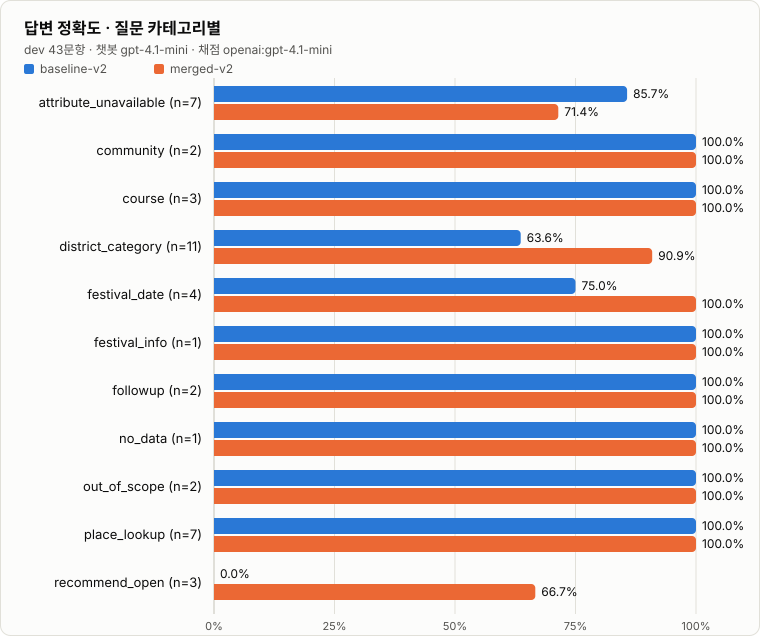

| category | 문항 | 검색 조건 충족률 | 답변 정확도 | 근거 충실도 |
| --- | ---: | ---: | ---: | ---: |
| attribute_unavailable | 7 | 38% → **100%** (1) | 86% → **71%** (7) | 100% (유지) (7) |
| community | 2 | - | 100% (유지) (2) | 100% (유지) (2) |
| course | 3 | - | 100% (유지) (3) | 100% (유지) (3) |
| district_category | 11 | 39% → **93%** (11) | 64% → **91%** (11) | 64% → **91%** (11) |
| festival_date | 4 | 100% (유지) (2) | 75% → **100%** (4) | 100% (유지) (4) |
| festival_info | 1 | - | 100% (유지) (1) | 100% (유지) (1) |
| followup | 2 | 0% → **100%** (1) | 100% (유지) (2) | 100% (유지) (2) |
| no_data | 1 | - | 100% (유지) (1) | 100% (유지) (1) |
| out_of_scope | 2 | - | 100% (유지) (2) | 100% (유지) (2) |
| place_lookup | 7 | - | 100% (유지) (7) | 100% (유지) (7) |
| recommend_open | 3 | - | 0% → **67%** (3) | 0% → **100%** (3) |

#### 여행자 유형별 (dev, ①→③)

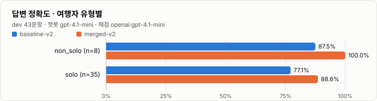

| traveler_type | 문항 | 검색 조건 충족률 | 답변 정확도 | 근거 충실도 |
| --- | ---: | ---: | ---: | ---: |
| non_solo | 8 | 25% → **100%** (2) | 88% → **100%** (8) | 100% (유지) (8) |
| solo | 35 | 47% → **94%** (13) | 77% → **89%** (35) | 80% → **97%** (35) |

셀은 `① → ③ (적용 문항 수)`이고, 변화가 없으면 `(유지)`로 표시했다.

#### 질문 단위 변화

| 비교 | 지표 | 개선 | 동일 | 악화 |
| --- | --- | ---: | ---: | ---: |
| dev ①→③ | 답변 정확도 | 6 | 36 | 1 |
| dev ①→③ | 근거 충실도 | 6 | 37 | 0 |
| dev ①→③ | 검색 조건 충족률 | 12 | 3 | 0 |
| holdout ①→③ | 답변 정확도 | 3 | 18 | 1 |
| holdout ①→③ | 검색 조건 충족률 | 8 | 0 | 0 |
| dev ②→③ (병합 효과) | 답변 정확도 | 3 | 37 | 3 |
| dev ②→③ (병합 효과) | 근거 충실도 | 0 | 42 | 1 |
| holdout ②→③ (병합 효과) | 답변 정확도 | 0 | 20 | 2 |

#### 결과 해석

- **원래 코드 대비(①→③) 검색은 분명히 좋아졌다.** 조건 충족률(dev +50.8p, holdout +73.4p)과 적중률(dev +14.3p)은 judge 없이 코드로 계산되는 값이라 가장 믿을 만하고, 질문 단위로 나빠진 것이 없다. 답변 정확도는 dev에서 +11.6p(개선 6·악화 1), holdout에서 +9.1p(개선 3·악화 1)였다. 정확도가 나빠진 질문은 dev의 계획형 시간표(`Q42`)와 holdout의 일본어 마포구 레저 질문(`Q23`)이다.
- **병합(②→③)은 품질을 높이지 않았고, 기능을 추가했다.** 검색 지표는 같고, 정확도는 dev에서 90.7%로 같지만 holdout에서는 95.5% → 86.4%로 내려갔다. 내려간 2문항 중 하나(`Q61`, Korean BBQ 식당 추천)는 RAG에 실제 식당 정보가 있어서 식당을 알려준 답변이 근거 있는 응답인데, 정답 기준이 "음식점 데이터 없음"으로 남아 있어 실패로 채점된 것이다(6절의 기준 갱신 때 이 항목은 확인하지 못했고, 사후 수정을 더 늘리지 않으려고 그대로 뒀다). 다른 하나(`Q23`)는 마포구 레포츠 검색 결과가 적어 문화시설·공연장이 함께 안내된 실제 조건 위반이다. 반면 병합으로 챗봇은 **실제 운영시간·입장료·휴무일과 행사 기간을 출처와 함께 답할 수 있게 됐다**(예: 남산서울타워 평일 10:00~22:30). 병합 전에는 이런 질문에 "정보가 없다"고만 답했다.
- **병합 후 코드를 두 번 측정한 값이 크게 달랐다.** 이전 후속 질문 승계 결함(군더더기 단어 `있나요` 때문에 지역을 승계하지 못함)을 고치기 전후로 병합 후를 측정했더니 dev 정확도 95.3% → 90.7%, holdout 95.5% → 86.4%였다. 코드 변경은 검색 한 가지(holdout 조건 충족률 90.6% → 100%로 개선)뿐이므로, **정확도 5~9p 차이는 대부분 LLM 응답·채점의 흔들림**으로 보는 편이 맞다. 이 README의 병합 후(③) 수치는 최종 코드로 측정한 두 번째 값이고, 첫 번째 측정 결과는 `docs/rag-eval/v2/`에 두지 않았다.
- **노이즈**: 코드를 바꾸지 않고 baseline을 두 번 측정(v1 평가셋)했을 때도 `answer_correctness`는 +2.3p, `answer_condition`(15문항)은 +13.3p 움직였다. 몇 p 단위의 judge 지표 변화는 해석하지 않는다.

### 8. 남은 문제

병합 후에도 만점이 아닌 질문이 dev에 8개, holdout에 3개 있다. 일반 원칙으로 풀기 어렵거나 후속 작업이 필요한 사례라 질문에 맞춘 땜질은 하지 않았다.

| 질문 | 현상 | 원인 / 비고 |
| --- | --- | --- |
| `[목표] 혼자 서울 1일 코스 …`, `6월 중순 … 경복궁→북촌한옥마을→광장시장` (계획형) | 궁궐 장소를 못 찾거나, 도보 이동 시간을 추정하고 근거 없는 입장료("무료")를 채움 | 시간표·동선 생성은 검색이 아니라 별도 추천 로직(코스 생성)이 필요. 계획형 표 요청에서 추정값을 채우는 경우가 남음 |
| `혼자 갈만한 곳`, `경복궁 입장료 … 혼자 가도 되지?`, `혼자 사진 찍으러 다니기 좋은 서울 장소` (holdout) | "혼자 가도 된다고 볼 수 있다", 사용자 표현 그대로 되풀이, 사진 명소 단정 | 데이터에 없는 적합성을 단정하는 경우가 남음. 프롬프트 규칙 3이 항상 지켜지지는 않는다 |
| `ソウルの麻浦区で … レジャー施設` (holdout) | 마포구 레포츠가 적어 문화시설·공연장까지 함께 안내(조건 위반) | 조건에 맞는 결과가 적을 때 다른 유형으로 채우는 동작을 막지 못함 |
| `When does the Seoul Spring Festival take place?`, `Ich reise allein … Kulturzentrum …` | 장소·유형을 검색하지 못함 | 번역 결과가 DB 표기와 맞지 않거나 `문화센터`를 `문화시설` 유형으로 인식하지 못함 |
| `남산타워 몇 시까지?` | `source_hit` 실패. 그러나 RAG 근거로 정확히 답함 | 사용자 별칭 `남산타워` ≠ DB의 `남산서울타워`. DB 검색은 놓쳤지만 RAG가 보완 |
| `Recommend some good Korean BBQ restaurants …` (holdout) | RAG의 실제 식당 정보로 답했지만 실패로 채점 | 정답 기준("음식점 데이터 없음")이 RAG 도입 전 기준으로 남아 있음. 평가셋 갱신 필요 |
| `[상황] 커플 데이트 … 남산골한옥마을` | 지표(`no_unsupported_price_hours`)가 "월요일 휴무"를 근거 없는 값으로 표시 | 근거의 "휴무일: 월요일"과 어순이 달라 생긴 지표 오탐. 답변 자체는 근거와 일치 |

### 9. 한계

- **표본이 작다.** 지표 대부분이 15~43문항, holdout은 22문항 기준이라 1~2문항 차이는 통계적으로 의미가 약하다. 조건이 있는 질문만 집계하는 지표(`source_condition_rate`, `answer_condition`)는 15문항, holdout은 8문항뿐이다.
- **LLM 지표는 노이즈가 있고, 개선 규칙과 평가 기준이 같은 방향이다.** 같은 코드를 두 번 측정해도 `answer_condition`이 +13.3p 움직였다. 또 프롬프트 규칙이 평가 기준이 묻는 행동("모른다고 답한다", "특성을 단정하지 않는다")과 같은 방향이므로 judge 지표의 상승폭에는 이 정렬 효과가 섞여 있다. 그래서 **검색 조건 충족률·검색 적중률·근거 없는 날짜처럼 judge 없이 계산되는 지표의 개선을 더 신뢰한다.**
- **평가셋 v2는 결과를 본 뒤에 일부 정답 기준을 고친 것이다.** 근거와 범위는 [6절](#6-평가셋-v2--rag-도입으로-바뀐-정답-기준)에 밝혔고 세 단계를 모두 v2로 다시 측정했지만, 기준을 사후에 바꿨다는 점은 감안해야 한다. 음식점 질문(`no_data`)처럼 RAG 때문에 낡은 기준이 아직 남아 있어, 병합 후 정확도는 실제보다 낮게 채점됐을 수 있다.
- **judge는 챗봇과 같은 `gpt-4.1-mini`다.** 자기 답변에 후할 수 있고, 채점 사유와 점수가 어긋난 항목도 있었다. 더 강한 모델을 `--judge-model`로 지정해 다시 측정하는 것이 좋다.
- **결정적 지표는 정규식 기반이다.** 날짜·금액·시각 탐지에 누락과 오탐이 있을 수 있다. 영어 `closed on …` 표현은 한국어 근거와 대조할 수 없어 탐지에서 뺐고, `07:00`과 `오전 7시`는 같은 시각으로 인정한다.
- **holdout은 완전한 미공개 데이터가 아니다.** 개선 전에 검색 단계 점검(`--retrieval-only`)을 holdout 포함 전체로 한 번 실행해 검색 실패 질문을 봤다. 개선은 개별 질문이 아니라 일반 원칙으로 했지만 엄밀한 미공개 검증은 아니다.
- 평가셋은 현재 DB 스냅샷(장소 6,518건, 일정 0건, 게시글 4건)과 RAG 인덱스(7,944 chunks)에 묶여 있다. RAG 원천 자료를 바꾸면 정답 기준을 다시 확인해야 한다.

---

## Data Model

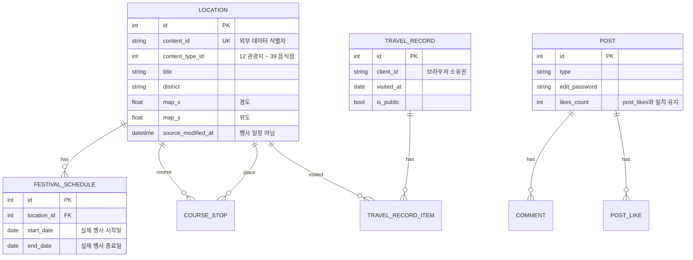

| contentTypeId | Category |
| ---: | --- |
| 12 | 관광지 |
| 14 | 문화시설 |
| 15 | 축제공연행사 |
| 25 | 여행코스 |
| 28 | 레포츠 |
| 32 | 숙박 |
| 38 | 쇼핑 |
| 39 | 음식점 |

> 원본 축제 JSON의 `createdtime`, `modifiedtime`은 데이터 생성·수정 시각이며 행사 일정이 아니다. 실제 일정은 `data/festival_schedules.json` → `FestivalSchedule`을 기준으로 한다.

---

## Performance Optimization & Troubleshooting

> **참고**: 이 섹션의 측정·원인 분석은 챗봇이 Gemini를 호출하던 시점에 수행한 기록이다. 이후 챗봇 모델을 OpenAI로 통일했고(`openai_client.py`), 비동기 호출·동시성 제한·캐시 구조는 그대로 유지했다.

> **측정 환경**: Windows 11, Python 3.12, FastAPI `TestClient`, 기존 `soulrip.db`(장소 6,518건) 복사본 + 벤치 데이터(게시글 30건×댓글 3개, 여행 기록 20건×장소 5개). 각 수치는 30회(지도·챗봇 10회) 요청의 **중앙값**이며, 같은 DB로 변경 전 코드(`HEAD`)와 변경 후 코드를 각각 실행해 비교했다. Gemini·OpenAI 실제 호출 지연은 키 없이 측정했으므로 포함하지 않았다.

### Summary

| # | 항목 | Before | After | 개선 |
| --- | --- | --- | --- | --- |
| 1 | 게시글 목록 12건 SQL 수 / 응답 | 14회 / 3.35ms | 3회 / 1.57ms | 쿼리 -79% |
| 2 | 여행코스 목록 12건 SQL 수 / 응답 | 14회 / 3.72ms | 3회 / 1.79ms | 쿼리 -79% |
| 3 | 여행 기록 20건(장소 5개씩) SQL 수 / 응답 | 21회 / 7.37ms | 2회 / 4.59ms | 쿼리 -90% |
| 4 | 주변 장소 반경 3km / 1km | 88.8ms / 132.5ms | 16.0ms / 2.9ms | 5.5배 / 45배 |
| 5 | `/meta/categories` | 8.89ms (SQL 1회) | 0.61ms (SQL 0회) | 14배 |
| 6 | 지도 2,000건 전송 크기 | 481,672B | 86,528B (gzip) | -82% |
| 7 | 챗봇 fallback 응답(RAG 검색 포함) | 32.4ms (RAG 없음) | 15.4ms | 근거 추가에도 단축 |
| 8 | `OPENAI_API_KEY` 미설정 시 서버 기동 | **기동 실패** | 정상 기동, 해당 API만 503 | 장애 범위 축소 |
| 9 | RAG 검색 / 인덱스 로드 | — | ≈1ms / 0.12s | 외부 호출 0회 |

### 1. OPENAI 키가 없으면 서버 전체가 뜨지 않는 문제

- **과정**: `OPENAI_API_KEY` 없이 변경 전 코드로 `app.main`을 import하면 `ValueError`로 앱 생성 자체가 실패하는 것을 재현했다. 챗봇만 쓰는 개발 환경에서도 OpenAI 키가 없으면 전체 API가 뜨지 않는다는 뜻이다.
- **원인 발견**: 트레이스백이 `ai_insight_service.py`의 `ValueError: OPENAI_API_KEY가 설정되지 않았습니다.`에서 멈췄다. 모듈 하단 `ai_insight_service = AIInsightService()`가 **import 시점에 키를 검사**하고 있어, 라우터 import → 앱 생성 단계에서 예외가 발생했다. 또한 라우터는 키 누락(서버 설정 문제)을 `ValueError` → **400(사용자 입력 오류)** 으로 응답하고, OpenAI SDK 예외가 아닌 `httpx` 예외를 잡고 있어 실제 연결 오류는 500이 되었다.
- **해결**: 클라이언트를 **첫 요청 시 지연 생성**하고 원인별 예외(`AIInsightConfigError`·`DataError`·`ResponseError`)를 분리했다. 라우터는 설정 누락·데이터 없음·연결 실패를 503, 응답 형식 오류를 502, 한도 초과를 429로 매핑하고 원인 메시지는 숨기지 않는다. 동기 DB 조회는 `to_thread`로 넘기고, 같은 날 인사이트는 TTL 캐시(10분)로 재사용한다.
- **결과**: 키가 없어도 서버는 정상 기동하고 `/ai-insights/today`만 `503 "OPENAI_API_KEY가 설정되지 않았습니다."`를 반환한다.

### 2. 목록 API의 N+1 쿼리

- **과정**: SQLAlchemy `before_cursor_execute` 이벤트로 요청당 SQL 수를 세어 보니, 게시글 12건 목록에 14회, 여행 기록 20건 목록에 21회의 SQL이 실행됐다.
- **원인 발견**: `_post_out()`이 게시글마다 `COUNT(comments)`를, `_course_out()`·`_record_out()`이 항목마다 경유지·장소 JOIN 쿼리를 따로 실행했다(목록 1 + 건수 N). 여행 기록 저장 시에도 장소마다 `content_id` 조회를 반복했다.
- **해결**: 목록의 id를 모아 **`GROUP BY` 한 번(댓글 수)**, **`IN (...)` + JOIN 한 번(경유지·기록 장소)** 으로 묶어 조회한 뒤 메모리에서 매핑한다. 단건 조회 함수는 기존 시그니처를 유지해 상세 API 동작은 그대로다. importer도 기존 장소를 `content_id` 맵으로 한 번에 읽어 항목별 SELECT(6,518회)를 제거했다(이 부분은 원본 JSON이 없어 쿼리 수 기준 분석).
- **결과**: 게시글 14→3회, 코스 14→3회, 여행 기록 21→2회. 목록 크기와 무관하게 쿼리 수가 고정된다.

### 3. 주변 장소 검색의 전체 스캔

- **과정**: 벤치마크에서 `/places/nearby`가 반경 1km 같은 좁은 검색에서도 88~132ms 걸렸다.
- **원인 발견**: 좌표가 있는 **모든 장소(약 6,500건)를 ORM 객체로 읽은 뒤** Python에서 haversine 거리를 계산하고 있었다. 반경이 작을수록 버려지는 객체가 대부분이었다.
- **해결**: 반경을 감싸는 **위경도 사각형(bounding box)** 조건을 SQL에 추가하고 `(map_y, map_x)` **복합 인덱스**를 만들었다. 사각형이 항상 원을 포함하도록 1도를 110km(실제 약 111km보다 작은 값)로 나눠 계산하고, 정확한 거리 판정과 정렬은 기존 `haversine_km`을 그대로 쓴다. 인덱스 사용으로 후보 순서가 바뀌므로 `ORDER BY id`로 동거리 정렬 순서를 기존과 같게 고정했다.
  - SpatiaLite·R-tree는 SQLite 확장 설치가 필요해 배포 복잡도가 커지므로 채택하지 않았다.
- **결과**: 3km 88.8→16.0ms, 1km 132.5→2.9ms. 4개 지점·반경(0.5~50km)에서 **전수 계산 결과와 total·순서가 완전히 일치**함을 확인했다.

### 4. 반복 집계 쿼리 — 캐시 전략 (Redis를 쓰지 않은 이유)

- **과정**: 홈·필터 화면이 열릴 때마다 `/meta/categories`, `/meta/districts`가 전체 장소 `GROUP BY`를 다시 실행했다.
- **원인 발견**: 이 집계는 **시드할 때만 바뀌는 값**인데 매 요청 계산하고 있었다.
- **해결**: 프로세스 메모리 **LRU + TTL 캐시**(`app/core/cache.py`)를 도입했다. 카테고리·자치구는 5분, 게시글 수가 포함된 `/meta/stats`는 30초로 짧게 둔다. 같은 캐시를 챗봇 응답·번역·RAG 검색·AI Insight에도 사용한다.
  - **Redis 대신 인메모리 캐시를 선택한 이유**: 현재 배포는 Render 단일 인스턴스 + SQLite 파일 DB라 프로세스 간 캐시 공유가 필요 없고, Redis를 추가하면 별도 인프라·네트워크 왕복·장애 지점이 생긴다. 워커를 여러 개로 늘리거나 서버를 수평 확장하는 시점에 Redis로 교체한다.
- **결과**: 8.89→0.61ms, 캐시 적중 시 SQL 0회.

### 5. 지도 API 응답 크기

- **과정**: 지도 화면용 `/places/map?limit=2000` 응답 크기를 재 보니 481,672B(약 470KB)였다. 모바일 네트워크에서는 전송 시간이 그대로 지도 표시 지연이 된다.
- **원인 발견**: 좌표·제목·이미지 URL이 반복되는 JSON을 압축 없이 전송했다.
- **해결**: `GZipMiddleware(minimum_size=1024)`를 추가했다. 작은 응답은 압축하지 않아 CPU 낭비를 피한다.
- **결과**: 전송 크기 481,672→86,528B(-82%). 응답 필드는 그대로다.

### 6. 챗봇 — 동기 외부 호출, 순차 처리, 연결 재생성

- **과정**: 챗봇 요청 경로를 코드로 따라가며 외부 호출이 어디서 대기하는지 점검했다.
- **원인 발견**: `/chat`은 `def` endpoint 안에서 `httpx.post()`를 **요청마다 새 연결로 동기 호출**해, Gemini 응답을 기다리는 동안 스레드풀 스레드 하나를 점유한다. 스레드풀(기본 40개)은 다른 `def` endpoint와 공유되므로 챗봇 요청이 몰리면 DB API까지 대기할 수 있는 구조였다. 번역 → DB 검색 → Gemini도 모두 순차였다.
- **해결**:
  - `/chat`을 `async def`로 바꾸고 **앱 공유 `httpx.AsyncClient`**(keep-alive 연결 풀)를 lifespan에서 생성·종료한다.
  - 서로 독립적인 **DB 검색(스레드)과 RAG 검색을 `asyncio.gather`로 동시에** 실행한다.
  - `asyncio.Semaphore`로 Gemini 동시 호출 수를 제한(기본 8)해 순간 트래픽의 429를 줄인다.
  - 같은 언어·질문·대화 맥락의 응답은 TTL 캐시로 재사용한다.
- **결과**: 키 없는 fallback 경로 기준 32.4→15.4ms(RAG 검색이 추가됐는데도 단축). Gemini 대기 중에도 이벤트 루프가 다른 요청을 처리한다. 캐시 적중 시 Gemini 호출 0회를 테스트로 확인했다.

### 7. 챗봇이 축제 "날짜"를 잘못 말하던 문제

- **과정**: RAG 근거를 Context에 합치기 위해 기존 Context 조립 코드를 점검했다.
- **원인 발견**: Context를 만들 때 `source_modified_at`(원본 데이터 **수정 시각**)을 `축제일:`로 표기해 Gemini에 넘기고 있었다. AI는 이 값을 실제 축제 날짜로 받아들일 수밖에 없다. 도메인 규칙("`modifiedtime`은 행사 일정이 아니다") 위반이다. 행사 보완 검색도 이미 끝난 일정까지 오래된 순으로 가져왔다.
- **해결**: `FestivalSchedule`이 있을 때만 `축제 일정: 시작~종료`를 넣고, 없으면 `축제 일정: 데이터 없음`으로 표기한다. 보완 검색은 `end_date >= 오늘` 조건을 추가했다. RAG의 서울시 문화행사 데이터는 실제 행사 기간을 가지고 있어 일정 근거로 함께 쓰인다.
- **결과**: 근거 없는 날짜가 Context에 들어가지 않으며, 시스템 프롬프트의 "날짜를 추측하지 않는다" 규칙과 데이터가 일치한다.

### 8. 토큰 낭비 — 대화 기록에 같은 질문이 두 번 들어가던 문제

- **과정**: 프론트엔드 `useChatbot.ts`가 보내는 history와 백엔드의 Gemini 요청 조립 코드를 대조했다.
- **원인 발견**: 프론트엔드가 현재 메시지를 대화 목록에 추가한 **뒤** 최근 기록을 잘라 `history`로 보내고, 백엔드는 그 history 뒤에 `질문: ...`을 한 번 더 붙여 **현재 질문이 두 번** 전달됐다. 첫 턴에는 의미 없는 인사말(assistant)도 포함됐다.
- **해결**: 백엔드에서 history 끝의 현재 질문과 동일한 user 메시지를 제거하고, 앞쪽 assistant 메시지를 제외하며, 최근 10개·메시지당 800자로 제한한다. Context도 7,000자, 답변은 `maxOutputTokens`로 상한을 둔다. 프론트엔드 측 수정 방법은 [가이드](docs/frontend-rag-integration.md)에 정리했다.
- **결과**: 첫 질문 기준 Gemini에 전달되는 턴이 3개(인사말·중복 질문·질문+근거) → 1개(질문+근거)로 줄었다. 인사말이 제거되어 첫 질문들의 캐시 키가 사용자 간 같아지는 효과도 있다.

### 9. RAG 설계 — 매 호출마다 자료를 가져오지 않는 구조

- **과정**: 실태조사 PDF 8종(약 800쪽), 통계표 5종, 서울시 공공데이터를 챗봇 근거로 써야 했다. 질문마다 자료를 프롬프트에 넣거나 임베딩 API를 호출하면 토큰·비용·지연이 커진다.
- **원인 분석**: 원천 자료를 텍스트로 바꾸면 약 673만 자다. 필요한 것은 "질문과 관련된 몇 개 단락"뿐이다.
- **해결**:
  - **오프라인 빌드**: `build_index.py`가 manifest의 자료를 chunk로 만들고 BM25 역색인을 **numpy CSR 배열**로 저장한다(postings 121만 개를 Python list 대신 int32/float32 배열로 저장해 메모리·로드 시간 절감).
  - **기동 시 1회 로드**: embedded 모드는 백엔드 lifespan에서, remote 모드는 rag-server lifespan에서 로드(0.12s)하고 이후 요청은 메모리 인덱스를 쓴다.
  - **메타데이터 우선 설계**: 모든 chunk에 연도·조사 대상·확정/잠정·출처가 붙고 Context 라벨로 전달된다. 시스템 프롬프트는 잠정치 명시, 연도 혼합 금지를 지시한다.
  - **벡터 DB(Chroma·FAISS 등)를 쓰지 않은 이유**: chunk가 약 8천 개로 메모리 배열로 충분하고, 새 라이브러리·서버 의존성을 늘리지 않는다는 프로젝트 원칙을 따랐다. 한국어 고유명사·연도·수치 질의는 키워드 매칭이 강하다. 의미 검색이 필요하면 `--embed`로 Gemini 임베딩을 **빌드 시 1회** 계산해 RRF로 결합할 수 있다.
  - **형태소 분석기 없이 한국어 검색**: "조사 제거 단어 + 한글 bigram" 토큰을 함께 색인해 "외국인관광객"처럼 붙여 쓴 표현도 찾는다.
- **결과**: 검색 ≈1ms, 외부 API 호출 0회, 질문당 근거는 최대 2,800자(전체의 약 0.04%), 인덱스 4.3MB.

### 10. RAG 검색 품질 튜닝

| 증상 | 원인 | 해결 | 결과 |
| --- | --- | --- | --- |
| 2025 자료 5종이 0 chunk로 빌드됨 | 파일명의 `[보고서]` 대괄호를 `glob` 문법으로 해석 | `*`, `?`가 있을 때만 glob 사용 | 5종 정상 색인(+2,854 chunk) |
| "이번 달 축제"에 설문지 페이지가 1위 | 보고서 부록 설문지의 "이번 서울 여행" 문구가 우연 일치 | 설문지형 페이지(문항 코드·①② 다수) 제외, 월 표현 인식 후 해당 기간 행사 ×1.6, 장소·행사 질문에서 실태조사 ×0.4 | 10월 진행 문화행사가 상위 |
| "2024년과 2025년 소비 패턴"에 2025만 검색 | 2024 보고서는 '소비' 대신 '지출' 표현, 문서당 상한만 존재 | 질의 확장(소비→지출·비용), 다중 연도 질문은 연도별 균등 배분 | 2024·2025 근거가 2개씩 |
| 일반 질문마다 '주요 용어 정리'가 상위 | 조사개요 페이지에 '외국인 관광객' 단어가 밀집 | 조사개요 페이지 표시 후 방법론 질문이 아니면 ×0.6 | 결과 페이지가 상위 |
| 쪽 머리말·세로 탭 글자(조/사/개/요) | PDF 레이아웃 텍스트 | 머리말·쪽번호·한 글자 줄 제거 | chunk 수 8,036→7,944, 노이즈 감소 |

### 11. Uvicorn 배포 설정 — 아티클 권장안을 그대로 쓰지 않은 부분

| 권장안 | 적용 | 이유 |
| --- | --- | --- |
| `--loop uvloop` | `uvloop`을 Linux에서만 설치(`sys_platform != "win32"`), uvicorn 기본 `--loop auto`가 자동 사용 | Windows 개발 환경에는 uvloop이 없음 |
| `--http h11` | **미적용**, 설치된 `httptools`를 자동 사용 | h11은 순수 Python 구현이라 C 기반 httptools보다 느리다 |
| `--workers 4` | `WEB_CONCURRENCY=1` 기본 | SQLite 쓰기 잠금, 워커별 캐시·RAG 인덱스 메모리 중복. 확장 시 DB·캐시를 먼저 분리 |
| 비동기 DB 드라이버(`databases`) | **미적용**, 동기 SQLAlchemy + 스레드풀 | 로컬 SQLite 파일 I/O는 짧고, aiosqlite도 내부적으로 스레드를 쓴다. 외부 I/O(AI)만 async로 전환 |
| 미들웨어 최소화·프로파일링 | 순수 ASGI `ProcessTimeMiddleware`(`X-Process-Time`) | `BaseHTTPMiddleware`의 추가 태스크 비용 없이 느린 endpoint를 바로 확인 |

추가로 SQLite는 `PRAGMA journal_mode=WAL`, `synchronous=NORMAL`, `busy_timeout=5000`을 적용해 좋아요·댓글 쓰기와 목록 읽기가 서로를 막지 않게 했다. 모델에 추가한 복합 인덱스는 `init_db()`가 기존 DB에도 `checkfirst`로 생성한다(`create_all`은 기존 테이블에 인덱스를 추가하지 않기 때문).

---

## Testing & Verification

이 저장소에는 아직 `pytest` 등 테스트 도구가 설정되어 있지 않다. 존재하지 않는 명령을 가정하지 않고 다음 순서로 검증한다.

```bash
# 1) 문법 검증
python -m compileall app scripts rag-server/rag rag-server/scripts rag-server/main.py

# 2) 서버 실행 후 상태 확인 (rag 값 확인)
uvicorn app.main:app --reload
curl http://127.0.0.1:8000/api/v1/health

# 3) Swagger(/docs)에서 endpoint · 스키마 · 상태코드 확인
```

이번 리팩터링은 기존 DB 복사본에 대해 FastAPI `TestClient`로 43개 항목을 확인했다(embedded·remote 모드 각각 통과).

- 장소 목록·지도(gzip)·상세 404, 주변 장소 total·정렬의 전수 계산 일치(4개 반경)
- 게시글 댓글 수 일괄 계산, 비밀번호 403/204, 좋아요 토글
- 여행 기록 생성·수정·삭제, 다른 `clientId` 접근 404, 없는 장소 400, 항목 순서 유지
- OpenAI 키 없이 기동 + 503, 챗봇 fallback·다국어 suggestions·빈 메시지 422
- OpenAI 모킹: history 정규화, 잠정치 라벨, 응답 캐시 적중, OpenAI 실패 시 fallback
- RAG remote 모드(API 키 인증), 잘못된 키·인덱스 누락 시 RAG 없이 정상 응답

---

## Deployment

`render.yaml` 기준 Render Web Service 1개로 배포한다.

```yaml
buildCommand: pip install -r requirements.txt && python -m scripts.seed_data
startCommand: uvicorn app.main:app --host 0.0.0.0 --port $PORT --proxy-headers --forwarded-allow-ips "*" --timeout-keep-alive 30
healthCheckPath: /api/v1/health
```

- RAG는 `RAG_MODE=embedded`로 같은 프로세스에서 동작한다. 커밋된 `rag-server/index`를 사용하므로 배포 시 PDF 파싱이 없다.
- 트래픽이 커지면 rag-server를 별도 서비스로 띄우고 `RAG_MODE=remote`로 전환한다.
- 원천 자료를 바꾸면 로컬에서 인덱스를 다시 빌드해 커밋한다. 2026 잠정치가 확정치로 바뀌면 `manifest.json`의 `status`를 `confirmed`로 바꾸고 다시 빌드한다.

---

## Frontend Integration

```env
VITE_API_BASE_URL=https://soulrip-backend.onrender.com/api/v1
```

RAG는 서버 내부에서만 동작하므로 **프론트엔드는 RAG 서버를 직접 호출하지 않고 키도 갖지 않는다.** `/chat` 요청 형식은 그대로이고, 응답 `sources`에 새 출처 유형(`REPORT`, `EVENT`, `PLACE_INFO`, `DATA`)과 선택 필드 `url`이 추가되었다.

프론트엔드에서 수정할 내용(타입, 출처 링크, history 구성, 오류 처리, 잠정치 배지 등)은 **[docs/frontend-rag-integration.md](docs/frontend-rag-integration.md)** 에 코드 예시와 함께 정리했다.

---

## Security Notes

현재 익명 커뮤니티는 프로젝트 요구사항에 맞춰 게시글·댓글 비밀번호를 단순 비교한다. 운영 환경으로 확장할 경우 다음을 우선 개선한다.

- 비밀번호 해시 저장
- 관리자 키·RAG 내부 키 관리 강화(secret manager)
- 요청 rate limit(특히 `/chat`, `/ai-insights`)
- 운영 DB 분리
- 로그에서 민감정보 제거

RAG 서버를 외부에 노출할 때는 `RAG_API_KEY`를 반드시 설정한다. API 키·관리자 키·DB URL은 코드에 하드코딩하지 않고 `Settings`로만 읽는다.

---

## Contributing

브랜치 이름(`feat/…`, `fix/…`), 커밋 메시지(`type(scope): 요약`), PR 규칙과 병합 전 확인 항목은 [`CONTRIBUTING.md`](CONTRIBUTING.md)에 있다. PR을 만들면 [`.github/pull_request_template.md`](.github/pull_request_template.md)가 자동으로 채워진다. `main`에 병합하면 Render가 배포하므로 병합 전에 검증과 환경변수 등록을 끝낸다.

---

## Harness Engineering

AI 코딩 도구가 구조와 도메인 규칙을 반복해서 추론하지 않도록 하네스 문서를 함께 관리한다.

```text
AGENTS.md                              # 최상위 규칙
.github/copilot-instructions.md
.github/instructions/*.instructions.md # 경로별 규칙
.github/prompts/*.prompt.md            # 반복 작업 절차
docs/harness/                          # 도메인·아키텍처·검증 문서
```

```text
Global   → 프로젝트 전체 불변조건
Domain   → 기능별 비즈니스 규칙
Local    → 경로별 코드 작성 규칙
Workflow → 반복 작업 실행 절차
```

자세한 사용법은 [`docs/harness/README.md`](docs/harness/README.md)를 참고한다.

### Development Principles

```text
요구사항 확인 → Router / Schema / Service / Model 탐색 → Frontend 계약 영향 확인
→ 최소 변경 구현 → 데이터 불변조건 검증 → API / 오류 / fallback 확인 → 문서·하네스 동기화
```

AI가 생성한 코드도 SQL 조건, 응답 Schema, 상태코드, 데이터 출처, 프론트엔드 계약을 개발자가 직접 검토하는 것을 기본 원칙으로 한다.
