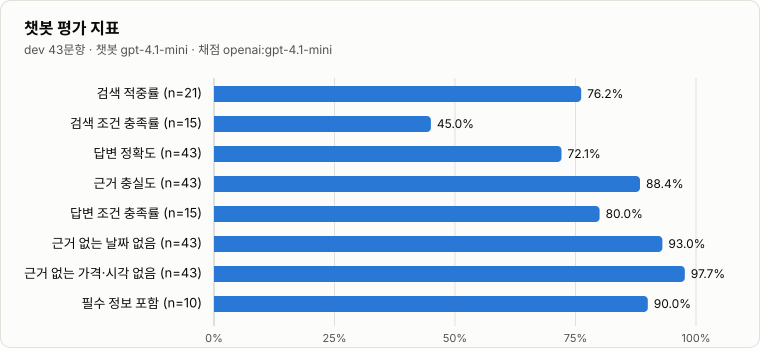
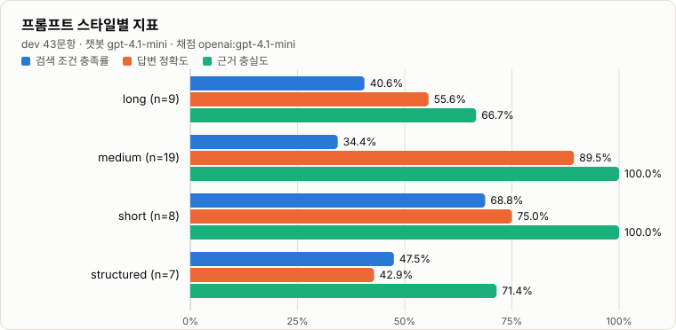
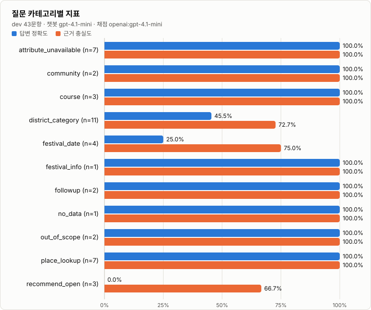
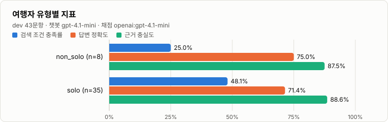
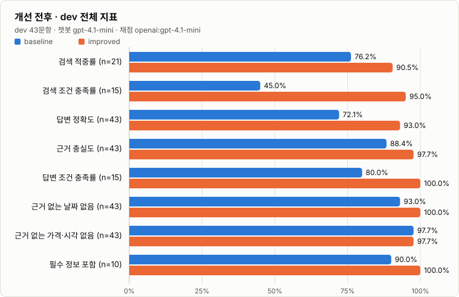
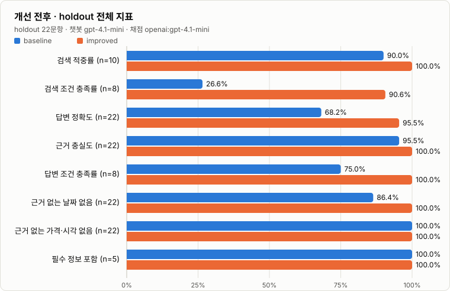
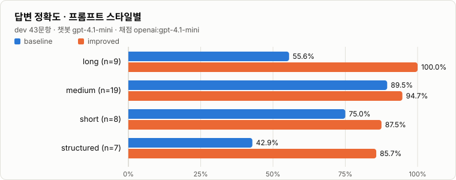
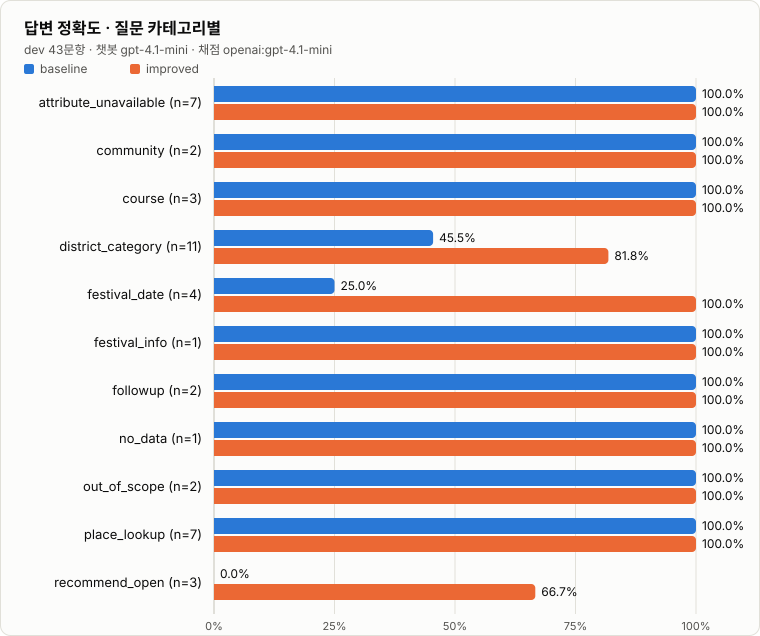
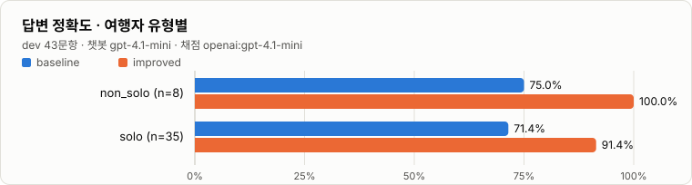

# Soulrip — Backend

> **Discover Solo → Plan Solo → Share Solo**  
> 혼자 떠나는 서울에서 나에게 맞는 장소와 여행 경험을 발견하고 공유하는 **AI 기반 Solo Travel Hub**이다.

Soulrip은 서울 지역 공공 관광 데이터를 혼행 사용자의 관점에서 재구성한 풀스택 웹 서비스이다. 사용자는 프론트엔드에서 장소와 축제를 탐색하고, AI에게 여행 정보를 질문하며, 익명 커뮤니티와 여행 기록을 통해 자신의 경험을 남길 수 있다.

이 저장소는 Soulrip 전체 서비스 중 **Backend API와 데이터 계층**을 담당한다. Vue 기반 프론트엔드와 REST API로 연결되며, 서울 관광 JSON 데이터를 SQLite에 적재하고 장소·축제·코스·커뮤니티·여행 기록·AI 기능에 필요한 API를 제공한다.

## Project Repositories

| Repository | Role | Link |
| --- | --- | --- |
| Frontend | Vue 3 기반 사용자 화면과 상호작용 | https://github.com/Soulrip-Trip/soul-frontend |
| Backend | FastAPI 기반 REST API, 데이터 처리, AI 연동 | https://github.com/Soulrip-Trip/soul-backend |

두 저장소는 하나의 Soulrip 서비스를 구성한다. 프론트엔드는 사용자 경험과 화면 상태를 담당하고, 백엔드는 데이터 조회·가공·영속화와 외부 AI API 연동을 담당한다.

---

## Project Overview

| Item | Description |
| --- | --- |
| Service | Soulrip |
| Region | Seoul |
| Development Period | n일 |
| Team | 3명 |
| Frontend | Vue 3, TypeScript, Vite |
| Backend | FastAPI, Python |
| ORM | SQLAlchemy |
| Database | SQLite |
| AI | OpenAI 기반 지역 정보 챗봇, OpenAI 기반 AI Insight |
| Deployment | Render |
| Data | 서울 지역 공공 관광 JSON 데이터 |

---

## Service Concept

Soulrip의 핵심 사용자 흐름은 다음과 같다.

```text
Discover Solo
      ↓
Plan Solo
      ↓
Share Solo
```

### Discover Solo

서울의 관광지, 문화시설, 레포츠, 쇼핑, 숙박, 여행코스, 축제·공연·행사 데이터를 탐색하는 단계이다. 백엔드는 검색, 카테고리, 자치구, 지도 좌표, 주변 장소, 상세 정보 등에 필요한 REST API를 제공한다.

### Plan Solo

사용자의 현재 상황과 관심사에 맞는 여행 선택지를 구체화하는 단계이다. 여행코스 추천 API와 지역 정보 챗봇, AI Insight를 통해 저장된 서울 데이터를 여행 의사결정에 활용한다.

### Share Solo

실제 혼행 경험을 기록하고 다른 사용자와 공유하는 단계이다. 익명 커뮤니티 CRUD, 댓글, 좋아요, 브라우저 `clientId` 기반 여행 기록 API를 제공한다.

---

## Full-stack Architecture

```text
┌─────────────────────────────────────────────┐
│               Soulrip Frontend              │
│          Vue 3 + TypeScript + Vite          │
│                                             │
│  Place / Festival / Course / Community      │
│  Travel Record / Chat UI / AI Insight UI    │
└──────────────────────┬──────────────────────┘
                       │ REST API
                       │ /api/v1
                       ▼
┌─────────────────────────────────────────────┐
│               Soulrip Backend               │
│                 FastAPI                     │
│                                             │
│  Router → Schema → Service → DB             │
│                                             │
│  Places / Festivals / Courses / Posts       │
│  Travel Records / Chat / AI Insights        │
└───────────────┬─────────────────┬───────────┘
                │                 │
                ▼                 ▼
       ┌────────────────┐  ┌──────────────────┐
       │ SQLite         │  │ External AI APIs │
       │ SQLAlchemy     │  │ OpenAI           │
       └───────┬────────┘  └──────────────────┘
               │
               ▼
       ┌────────────────┐
       │ Seoul JSON Data│
       │ + Schedules    │
       └────────────────┘
```

프론트엔드가 API 계약을 소비하고 백엔드가 데이터와 도메인 규칙의 기준을 제공하는 구조이다. API 필드명이나 동작을 변경할 때는 한 저장소만 보고 판단하지 않고 프론트엔드 영향 범위도 함께 확인해야 한다.

---

## Backend Architecture

```text
app/
├─ core/                 # 환경설정과 공통 설정
├─ db/                   # DB 연결과 SQLAlchemy 모델
├─ routers/              # HTTP endpoint와 요청 흐름
├─ schemas/              # Pydantic 요청/응답 계약
├─ services/             # AI, 추천, 직렬화, 데이터 적재 로직
└─ main.py               # FastAPI 앱과 Router 등록

data/
├─ festival_schedules.json
├─ festival_schedules.example.json
└─ eval/
   └─ chat_eval_set.json   # 챗봇 RAG 평가셋

scripts/
├─ check_data.py
├─ seed_data.py
└─ chat_eval/              # 챗봇 RAG 평가 (LangSmith)
```

새 기능은 기존 구조에서 가장 가까운 도메인의 Router, Schema, Service, Model 패턴을 먼저 확인한 뒤 확장한다.

---

## Core Features

### Place Discovery

- 장소 목록 및 상세 조회를 제공한다.
- 검색어, 카테고리, 자치구 등의 조건을 처리한다.
- 지도 표시용 장소 데이터와 주변 장소 검색을 지원한다.
- 좌표 기반 계산은 기존 추천 유틸리티를 재사용한다.

### Festival Discovery

- 축제 목록과 상세 정보를 제공한다.
- 월별 캘린더와 특정 날짜 기준 조회를 지원한다.
- 실제 행사 일정은 `FestivalSchedule`을 기준으로 관리한다.
- 관리자 키를 사용하는 일정 보완 API가 존재한다.

### Course Recommendation

- 저장된 여행코스 목록과 상세를 제공한다.
- 후보 장소를 필터링한 뒤 거리 기반 순서를 계산하여 간단한 혼행 코스를 생성한다.
- 추천 결과는 사용자의 자치구, 콘텐츠 유형, 이동수단, 소요시간 등의 입력을 고려한다.

### Anonymous Community

- 로그인 없는 익명 게시글 CRUD를 제공한다.
- 댓글 작성·수정·삭제를 제공한다.
- 좋아요 기능을 제공한다.
- 수정과 삭제 권한은 현재 비밀번호 기반 흐름을 사용한다.

### Travel Records

- 브라우저의 `clientId`를 기준으로 사용자의 여행 기록을 구분한다.
- 목록, 상세, 생성, 수정, 삭제 API를 제공한다.
- 별도의 회원 시스템이 없다는 서비스 전제를 유지한다.

### AI Local Guide

지역 정보 챗봇은 다음 흐름으로 동작한다.

```text
사용자 질문
   ↓
검색어·조건(지역/유형) 추출
   ↓
SQLite에서 장소 / 축제 / 게시글 검색
   ↓
검색된 데이터로 Context 생성
   ↓
OpenAI에 Context + History 전달
   ↓
답변 + Source 반환
```

AI가 임의의 서울 정보를 생성하도록 하지 않고 **저장된 데이터 검색 결과를 우선 근거로 사용**하는 구조이다. OpenAI API 키가 없거나 외부 호출이 실패해도 검색 결과를 기반으로 fallback 응답을 반환한다.

### AI Insight

AI Insight는 저장된 장소와 축제 데이터를 추려 OpenAI에 전달하고 구조화된 JSON 응답을 생성하는 기능이다.

- 입력 데이터에 없는 장소를 추측하지 않는다.
- 이미지 URL은 입력 데이터에 존재하는 URL만 사용한다.
- 구조화된 JSON Schema를 기준으로 응답을 검증한다.
- 관광 데이터가 없는 경우 임의의 결과를 생성하지 않는다.

---

## RAG Evaluation

지역 정보 챗봇이 **사용자의 조건(지역·유형)을 지키고, 저장된 데이터에 근거해서만 답하는지**를 "느낌"이 아니라 수치로 검증한다. 서비스 런타임과 분리된 개발용 도구이며 `scripts/chat_eval/`에 있다. 실험은 LangSmith에 기록해 질문별 trace와 전후 비교를 웹에서 볼 수 있다.

### 진행 방식

```text
① 평가셋 작성        65문항, 정답은 soulrip.db 실데이터 기준                    ✅ 완료
② baseline 측정      개선 전 코드로 dev 43문항 · holdout 22문항 실행 → LangSmith   ✅ 완료
③ 실패 사례 분석     조건 누락 · 근거 없는 답변을 질문 단위로 확인                ✅ 완료
④ 검색/프롬프트 개선  분석한 문제 8개 중 7개를 일반 원칙으로 수정 (#3 번역 품질은 일부만 해결)            ✅ 완료
⑤ 같은 dev로 재측정  개선 전후 정확도·충실도·조건 충족률 비교                     ✅ 완료
⑥ holdout 최종 검증  개선에 쓰지 않은 질문으로 개선 전후 1회씩 측정                ✅ 완료
```

**한 줄 결과** — dev 기준 검색 조건 충족률 **45.0% → 95.0%**, 답변 정확도 **72.1% → 93.0%**, 근거 충실도 **88.4% → 97.7%**. 개선 전에 비해 나빠진 질문은 dev·holdout 모두 0개였다. 아직 남은 문제는 [8. 남은 문제](#8-남은-문제)에 적었다.

개선에 쓰는 질문(`dev`)과 최종 검증용 질문(`holdout`)을 분리했다. 같은 질문을 보며 프롬프트를 고치면 그 질문에만 최적화될 수 있기 때문이다.

### 1. 평가셋 설계

`data/eval/chat_eval_set.json` — 65문항. **정답은 `soulrip.db`의 실제 데이터**로 작성했다(content_id, 지역·유형 조건, 전화번호 등). 이 DB에는 입장료·운영시간·행사 일정·장소 설명이 없으므로, 그런 정보를 물으면 **"모른다"고 답하는 것이 정답**인 질문을 일부러 넣었다. 질문마다 페르소나와 프롬프트 스타일을 붙여 어떤 사용자·어떤 입력 형태에서 약한지 나눠 볼 수 있다.

**프롬프트 스타일 4종**

| 스타일 | 문항 | 실제 질문 예 |
| --- | ---: | --- |
| `short` 키워드 | 12 | `마포구 레포츠` |
| `medium` 한 문장 | 33 | `혼자 가도 부담 없는 종로구 문화시설 알려줘` |
| `long` 상황 서술 | 12 | `이번 주말에 혼자 조용히 쉬고 싶어서 강남구에 있는 문화시설을 찾고 있어요. 사람 너무 많은 곳은 피하고 싶고, 혼자 둘러보기 좋은 곳이면 좋겠어요. 몇 군데 알려주세요.` |
| `structured` 계획형 | 8 | `[지역] 용산구 / [유형] 관광지 / [인원] 1명 / [요청] 3곳 추천 + 각 장소의 주소 / [주의] 데이터에 없는 영업시간, 입장료는 쓰지 말 것` (실제 입력은 항목별 줄바꿈) |

**페르소나 18종 — 혼행자 54문항(83%), 그 외 11문항**

| 그룹 | 페르소나 (문항 수) |
| --- | --- |
| 혼행 · 내국인 (40) | 첫 혼행 7, 계획형 7, 대학생 6, 즉흥형 5, 직장인 5, 혼밥 4, 사진 3, 시니어 3 |
| 혼행 · 외국인 (14) | 영어 7, 일본어 3, 중국어 1, 프랑스어 1, 스페인어 1, 독일어 1 |
| 그 외 (11) | 커플 7, 친구 2, 부모님 동반 1, 서울 거주자 1 |

**질문 카테고리 11종**

| 카테고리 | 문항 | 확인하려는 것 |
| --- | ---: | --- |
| `district_category` | 15 | "종로구 문화시설"처럼 지역·유형 조건을 지키는가 |
| `place_lookup` | 11 | 특정 장소의 위치를 데이터대로 답하는가 |
| `attribute_unavailable` | 10 | 가격·시간·시설처럼 데이터에 없는 정보를 지어내지 않는가 |
| `festival_date` / `festival_info` | 6 / 2 | 데이터에 없는 행사 날짜를 말하지 않고, 있는 전화번호는 알려주는가 |
| `recommend_open` | 6 | 열린 추천에서 "조용하다·혼자 가기 좋다" 같은 근거 없는 수식어를 붙이지 않는가 |
| `course` / `community` | 4 / 3 | 코스 경유지·후기를 지어내지 않는가 |
| `followup` | 4 | 이전 대화의 지역·조건을 이어받는가 |
| `no_data` / `out_of_scope` | 2 / 2 | 음식점(데이터 없음)·타 지역·날씨 질문에 맛집/정보를 지어내지 않는가 |

언어는 ko 51, en 7, ja 3, zh·fr·es·de 각 1문항이다. 평가셋은 현재 DB 스냅샷에 묶여 있으므로 DB를 다시 시드했다면 `python -m scripts.chat_eval check`로 정답이 유효한지 먼저 확인한다.

### 2. 지표

| 지표 | 방식 | 의미 |
| --- | --- | --- |
| `source_hit` 검색 적중률 | 결정적 | 기대한 장소·게시글이 `sources`에 들어왔는가 |
| `source_condition_rate` 검색 조건 충족률 | 결정적 | `sources` 중 질문의 지역·유형 조건을 만족하는 비율 |
| `answer_correctness` 답변 정확도 | LLM judge | 정답 기준(criteria)을 만족하는가. 정보 없음 질문은 "모른다"고 답해야 통과 |
| `faithfulness` 근거 충실도 | LLM judge | 답변의 모든 주장이 검색 컨텍스트에 근거하는가 |
| `answer_condition` 답변 조건 충족률 | LLM judge | 답변이 제시한 장소가 질문의 조건을 만족하는가 |
| `no_unsupported_date` | 결정적 | 답변의 날짜가 `FestivalSchedule` 또는 질문에 근거하는가. 검색 컨텍스트에 날짜가 있어도 `modifiedtime`은 일정으로 인정하지 않는다 |
| `no_unsupported_price_hours` | 결정적 | 답변의 금액·시각·휴무 표현이 컨텍스트 또는 질문에 있는가 |
| `must_include` / `language_match` | 결정적 | 필수 키워드(예: 전화번호) 포함 / 요청 언어로 답했는가 |
| `used_ai` | 결정적 | OpenAI 호출 성공 여부. 0이면 fallback 답변이므로 해당 질문은 답변 지표에서 제외 |

결정적 지표는 코드로 계산해 재현된다. LLM judge는 질문당 1회 호출해 정확도·충실도·조건 충족을 함께 0/1로 채점한다. 결과는 카테고리, 프롬프트 스타일, 여행자 유형, 페르소나, 언어별로 나눠 집계한다.

### 3. 실행 방법

```bash
pip install -r requirements-eval.txt        # 평가 전용 의존성 (서비스 배포에는 포함되지 않음)
python -m scripts.chat_eval check           # 평가셋 형식 · DB 정답 검증

# LangSmith에 평가셋을 올리고 전체 평가를 기록
python -m scripts.chat_eval sync
python -m scripts.chat_eval run --tag baseline          # dev 43문항
python -m scripts.chat_eval run --tag prompt-v2         # 수정 후 같은 dev로 재측정
python -m scripts.chat_eval run --split holdout --tag final   # 개선을 마친 뒤 1회

# 업로드 없이 로컬에서만 / LLM 호출 없이 검색 지표만
python -m scripts.chat_eval run --local --tag baseline
python -m scripts.chat_eval run --local --retrieval-only --split all --tag baseline

# 결과 활용
python -m scripts.chat_eval compare <before> <after>             # 지표별 증감 + 오히려 나빠진 질문 목록
python -m scripts.chat_eval chart <before> <after> --out docs/rag-eval/after-overall.svg   # 전후 막대그래프
python -m scripts.chat_eval table <결과> --by category            # README용 마크다운 표
```

필요한 환경변수는 `OPENAI_API_KEY`(챗봇과 judge)와 `LANGSMITH_API_KEY`(업로드)이다. 각 실험 metadata에는 git commit, `app/` 변경 여부, 시스템 프롬프트 해시, 챗봇·judge 모델이 기록된다. LangSmith에서는 Datasets & Experiments → `soulrip-chatbot-eval` → Experiments 탭에서 실험을 선택해 질문별 trace와 비교 화면을 볼 수 있다.

### 4. Baseline 결과 (2026-10-26, 실측)

| 항목 | 값 |
| --- | --- |
| 평가 대상 | `dev` 43문항 (holdout 미사용) |
| 챗봇 / judge | `gpt-4.1-mini` / `gpt-4.1-mini` |
| 코드 상태 | 검색 로직과 시스템 프롬프트(해시 `092705f8`)는 `bc9f81b`와 동일. 챗봇 모델만 OpenAI로 전환하고 평가 하네스를 반영한 작업 트리 |
| LangSmith 실험 | `baseline-dev-full-1bb7b55a` |
| 원본 결과 | [`docs/rag-eval/baseline-dev.json`](docs/rag-eval/baseline-dev.json) (질문별 답변·점수·채점 사유) |



| 지표 | 점수 | 적용 문항 |
| --- | ---: | ---: |
| 검색 적중률 (`source_hit`) | 76.2% | 21 |
| 검색 조건 충족률 (`source_condition_rate`) | 45.0% | 15 |
| 답변 정확도 (`answer_correctness`) | 72.1% | 43 |
| 근거 충실도 (`faithfulness`) | 88.4% | 43 |
| 답변 조건 충족률 (`answer_condition`) | 80.0% | 15 |
| 근거 없는 날짜 없음 (`no_unsupported_date`) | 93.0% | 43 |
| 근거 없는 가격·시각 없음 (`no_unsupported_price_hours`) | 97.7% | 43 |
| 필수 정보 포함 (`must_include`) | 90.0% | 10 |

요청 언어 일치(`language_match`)와 OpenAI 호출 성공(`used_ai`)은 모두 100%(43/43)였다. 표의 지표는 해당 조건이 있는 질문에만 적용되므로 "적용 문항"이 다르다.

**프롬프트 스타일별** — 질문이 길고 복잡해질수록 정확도와 충실도가 떨어진다.



| 스타일 | 문항 | 검색 조건 충족률 | 답변 정확도 | 근거 충실도 | 답변 조건 충족률 |
| --- | ---: | ---: | ---: | ---: | ---: |
| long | 9 | 41% (4) | 56% (9) | 67% (9) | 75% (4) |
| medium | 19 | 34% (4) | 89% (19) | 100% (19) | 100% (4) |
| short | 8 | 69% (2) | 75% (8) | 100% (8) | 100% (2) |
| structured | 7 | 48% (5) | 43% (7) | 71% (7) | 60% (5) |

**질문 카테고리별** — 약한 곳은 지역·유형 조건, 축제 날짜, 열린 추천에 몰려 있다.



| 카테고리 | 문항 | 검색 조건 충족률 | 답변 정확도 | 근거 충실도 | 답변 조건 충족률 |
| --- | ---: | ---: | ---: | ---: | ---: |
| attribute_unavailable | 7 | 38% (1) | 100% (7) | 100% (7) | 0% (1) |
| community | 2 | - | 100% (2) | 100% (2) | - |
| course | 3 | - | 100% (3) | 100% (3) | - |
| district_category | 11 | 40% (11) | 45% (11) | 73% (11) | 82% (11) |
| festival_date | 4 | 100% (2) | 25% (4) | 75% (4) | 100% (2) |
| festival_info | 1 | - | 100% (1) | 100% (1) | - |
| followup | 2 | 0% (1) | 100% (2) | 100% (2) | 100% (1) |
| no_data | 1 | - | 100% (1) | 100% (1) | - |
| out_of_scope | 2 | - | 100% (2) | 100% (2) | - |
| place_lookup | 7 | - | 100% (7) | 100% (7) | - |
| recommend_open | 3 | - | 0% (3) | 67% (3) | - |

**여행자 유형별** (혼행 vs 그 외)



| 유형 | 문항 | 검색 조건 충족률 | 답변 정확도 | 근거 충실도 | 답변 조건 충족률 |
| --- | ---: | ---: | ---: | ---: | ---: |
| solo (혼행) | 35 | 48% (13) | 71% (35) | 89% (35) | 85% (13) |
| non_solo | 8 | 25% (2) | 75% (8) | 88% (8) | 50% (2) |

<details>
<summary>페르소나별 · 언어별 표</summary>

| 페르소나 | 문항 | 검색 조건 충족률 | 답변 정확도 | 근거 충실도 | 답변 조건 충족률 |
| --- | ---: | ---: | ---: | ---: | ---: |
| couple | 7 | 25% (2) | 71% (7) | 86% (7) | 50% (2) |
| local_resident | 1 | - | 100% (1) | 100% (1) | - |
| solo_first_timer | 6 | 50% (2) | 67% (6) | 83% (6) | 100% (2) |
| solo_foodie | 3 | - | 100% (3) | 100% (3) | - |
| solo_foreigner_de | 1 | 25% (1) | 100% (1) | 100% (1) | 100% (1) |
| solo_foreigner_en | 4 | 6% (2) | 100% (4) | 100% (4) | 50% (2) |
| solo_office_worker | 4 | 88% (1) | 50% (4) | 75% (4) | 100% (1) |
| solo_photographer | 2 | 50% (1) | 50% (2) | 50% (2) | 100% (1) |
| solo_planner | 4 | 62% (3) | 50% (4) | 75% (4) | 67% (3) |
| solo_senior | 2 | 25% (1) | 50% (2) | 100% (2) | 100% (1) |
| solo_spontaneous | 5 | 69% (2) | 60% (5) | 100% (5) | 100% (2) |
| solo_student | 4 | - | 100% (4) | 100% (4) | - |

| 언어 | 문항 | 검색 조건 충족률 | 답변 정확도 | 근거 충실도 | 답변 조건 충족률 |
| --- | ---: | ---: | ---: | ---: | ---: |
| ko | 38 | 53% (12) | 68% (38) | 87% (38) | 83% (12) |
| en | 4 | 6% (2) | 100% (4) | 100% (4) | 50% (2) |
| de | 1 | 25% (1) | 100% (1) | 100% (1) | 100% (1) |

</details>

셀은 `점수 (적용 문항 수)`이다. 페르소나·언어별 문항 수가 1~7개라서 개별 비율은 참고용으로만 본다.

### 5. 실패 사례 분석

baseline에서 만점이 아니었던 질문 23개를 질문 단위로 확인했다(원본 답변과 채점 사유는 결과 JSON에 있다). 원인에 "코드 확인"이라고 적은 항목은 코드를 직접 읽고 해당 질문의 검색어·컨텍스트를 재현해 확인한 것이고, "가설"은 검증하지 않은 추정이다.

| # | 문제 | 근거 (baseline 실측) | 원인 |
| --- | --- | --- | --- |
| 1 | **행사 날짜 환각** | `no_unsupported_date` 실패 3건, `festival_date` 정확도 25%. 답변에 `축제일 2025-10-23`, `6월 5일`, `2026-05-06` 같은 날짜가 등장 | 코드 확인: `_search_context`가 `FestivalSchedule`이 없는 축제의 컨텍스트에 `source_modified_at`을 `축제일`로 넣는다. 원본 `modifiedtime`은 행사 일정이 아니다(Festivals 불변조건 위반) |
| 2 | **지역·유형 조건 누락(검색)** | `source_condition_rate` 45.0%. 예: `마포구에 커플이 묵을 만한 숙박시설` → 검색된 8곳 중 조건에 맞는 곳은 1곳 | 코드 확인: 검색어 중 하나라도 맞으면 후보에 넣는 OR 조건이고, 후보를 수정일 순 상위 100개로 자른 뒤에야 일치 개수로 정렬한다 |
| 3 | **영어·독일어 질문의 검색 품질** | 검색 조건 충족률 en 6%(n=2), de 25%(n=1) | 가설: 번역된 검색어가 지역 조건을 살리지 못함. 표본이 작아 확정하기 어려움 |
| 4 | **이전 대화 조건 유실** | `followup` 검색 조건 충족률 0%. `그럼 거기서 가까운 숙박도 알려줘` → 검색 결과 0건 | 코드 확인: 검색은 현재 메시지만 사용하고 history는 LLM 호출에만 전달한다 |
| 5 | **근거 없는 수식어** | `recommend_open` 정확도 0%(0/3), `long` 정확도 56%. 예: `이곳들은 상대적으로 조용히 혼자 관람하기 좋을 것으로 보입니다` | 프롬프트가 "영업시간·가격·축제 날짜"만 금지하고 장소의 분위기·적합성 단정은 막지 않는다 |
| 6 | **계획형 입력에서 시간표 날조** | `structured` 정확도 43%, 충실도 71%. 1일 코스 요청에 `10:00~12:00 …` 시간표를 채움 | 시간표 형식 요청에 응하다 데이터에 없는 시각을 만듦 |
| 7 | **긴 질문에서 핵심 장소명이 검색어에서 잘림** | `long` 검색 적중률 50%. `창덕궁 달빛기행` 문의는 검색 0건이라 데이터에 있는 전화번호(1522-2295)를 "없다"고 답함. `경복궁→북촌한옥마을→광장시장` 질문도 0/3 | 코드 확인: `_search_terms`가 질문의 **앞 8단어만** 검색어로 쓴다. 추출된 검색어가 `다음, 달에, 남자친구랑, 야간, …`이어서 `창덕궁`, `달빛기행`이 빠졌다 |
| 8 | **유형 표현이 DB의 유형명과 어긋남** | 위 2번 예시의 `숙박시설` 검색 | 코드 확인: 유형 매칭이 `content_type ILIKE '%숙박시설%'`인데 DB 값은 `숙박`이라 매칭되지 않는다. 대신 `커플`이 `슈마커플러스` 같은 상호에 걸렸다 |

**잘 동작한 것**: 입장료·운영시간처럼 데이터에 없는 정보를 물으면 지어내지 않고 모른다고 답했다(`attribute_unavailable` 정확도 7/7). 장소 조회 7/7, 커뮤니티·코스 질문 5/5, 요청 언어 일치 43/43이었다. 개선 후에도 이 항목들이 유지되는지 함께 확인했다.

**프롬프트만으로 해결되는 문제(5, 6)와 검색·코드 수정이 필요한 문제(1, 2, 4, 7, 8)가 섞여 있다.** 조건 충족률 45%는 프롬프트를 다듬어도 오르지 않는 구간이라, 검색 단계를 먼저 고쳤다.

### 6. 무엇을 어떻게 바꿨나

변경은 `app/services/chat_service.py`(검색·프롬프트)와 평가 하네스(`scripts/chat_eval/target.py`가 history를 검색에 넘기도록)뿐이다. **API 요청·응답 필드(`answer`, `sources`, `suggestions`, `usedAi`), `/api/v1/chat` 경로, OpenAI 실패 시 fallback은 그대로**이다. 특정 평가 질문에 맞춘 규칙은 넣지 않고, 위 원인에 대응하는 일반 원칙으로만 고쳤다.

| 해결한 문제 | 변경 전 | 변경 후 |
| --- | --- | --- |
| **#7 긴 질문에서 장소명 잘림** | 질문의 앞 8단어를 검색어로 사용 | 질문에서 단어를 모두 뽑은 뒤 **DB에 실제로 있는 단어만** 검색어로 사용(단어별 일치 장소 수를 query 1회로 집계). 600개를 넘는 장소에 걸리는 흔한 단어는 제외 |
| **#2, #8 지역·유형 조건 누락** | 모든 검색어를 OR로 합친 뒤 수정일순 상위 100개만 정렬 | 질문에서 **자치구·유형을 추출**해 필터로 먼저 적용(`숙박시설`·`호텔`→숙박, `행사`·`공연`→축제공연행사 등). 필터 안에서 검색어로 좁히고, 결과가 없으면 필터만, 그래도 없으면 기존 방식으로 완화한다. 후보 한도는 400개 |
| **순위 매기기** | 일치한 단어 개수가 같으면 수정일순 | 드문 단어에 일치할수록, 제목과 사실상 같은 장소명일수록 앞에 둔다(역빈도 가중치) |
| **#4 이전 대화 조건 유실** | 검색은 현재 메시지만 사용 | 현재 메시지에 지역도 장소명도 없고 지시어("거기", "그 근처")뿐이면 **이전 대화의 지역을 이어받는다**. 영문 자치구 표기도 인식 |
| **#1 행사 날짜 환각** | 컨텍스트에 `축제일: {source_modified_at}` 노출 | 수정 시각을 컨텍스트에서 제거. `FestivalSchedule`이 있으면 `일정: 시작~종료`, 없으면 `일정: 저장된 데이터에 없음`으로 표기 |
| 커뮤니티 글 보장 | 장소 8개가 차면 `sources[:8]`에 밀려 글 카드가 사라짐 | 2개 이상 단어가 일치한 글에 최대 2자리를 보장. 카드와 LLM 컨텍스트가 같은 목록을 쓰도록 맞춤 |
| **#5, #6 수식어·시간표 날조** (프롬프트) | "영업시간·가격·축제 날짜를 추측하지 않는다" | 규칙 6개로 구체화: 조건에 맞는 장소만 제시 / 일정·시각·가격·이동시간은 없으면 "정보 없음"(시간표 요청에도 시각을 만들지 않음) / 분위기·혼자 가기 좋음·조용함 같은 특성 단정 금지 / 문의 전화번호는 그대로 안내 |

<details>
<summary>시스템 프롬프트 전문 (Before / After)</summary>

**Before** (해시 `092705f8`)

```text
너는 Soulrip 서울 여행 도우미다. 반드시 제공된 데이터 문맥만 근거로 답하고, 문맥에 없는 영업시간·가격·축제 날짜를 추측하지 않는다. 검색 결과가 없으면 모른다고 답한다. 답변에 사용한 장소명은 제공된 표기를 그대로 쓴다. Answer concisely in {language}.
```

**After** (해시 `48018a31`)

```text
너는 Soulrip 서울 여행 도우미다. 반드시 제공된 데이터 문맥만 근거로 답한다. 규칙은 다음과 같다.
1) 사용자가 말한 지역·유형 조건에 맞는 장소만 제시하고, 조건에 맞는 장소가 문맥에 없으면 없다고 답한다.
2) 영업시간·가격·입장료·행사 일정·날짜·소요 시간·이동 시간·예약 방법·시설 정보가 문맥에 없으면 추측하지 말고 '저장된 데이터에 정보가 없다'고 답한다. 시간표나 표를 요청받아도 문맥에 없는 시각과 날짜는 만들지 않고 '정보 없음'으로 적는다.
3) 장소의 분위기·혼자 가기 좋음·조용함·안전·접근성·사진 명소 같은 특성은 문맥에 없으면 말하지 않는다. 장소는 이름·유형·주소처럼 제공된 정보로만 소개한다.
4) 문맥에 문의 전화번호가 있으면 그대로 알려준다.
5) 검색 결과가 없으면 모른다고 답한다.
6) 답변에 사용한 장소명은 제공된 표기를 그대로 쓴다.
Answer concisely in {language}.
```

</details>

비용 측면에서 검색 1회당 DB query가 기존 2~3회에서 평균 3.5회(한국어 51문항 기준)로 늘었다(단어 빈도 집계 1회, 축제 일정 조회 1회). 응답 시간은 따로 측정하지 않았다.

### 7. 개선 전후 비교 (2026-10-26, 실측)

| 항목 | Before | After |
| --- | --- | --- |
| 코드 | 시스템 프롬프트 해시 `092705f8`, 기존 검색 | 해시 `48018a31`, 위 변경 반영 |
| 챗봇 / judge | `gpt-4.1-mini` / `gpt-4.1-mini` (동일) | 동일 |
| dev 43문항 실험 | `baseline-dev-full-1bb7b55a` | `improved-dev-full-ee701315` |
| holdout 22문항 실험 | `baseline-holdout-full-d89b0d0b` | `improved-holdout-full-055bf74c` |
| 원본 결과 | [`baseline-dev.json`](docs/rag-eval/baseline-dev.json) · [`baseline-holdout.json`](docs/rag-eval/baseline-holdout.json) | [`improved-dev.json`](docs/rag-eval/improved-dev.json) · [`improved-holdout.json`](docs/rag-eval/improved-holdout.json) |

같은 평가셋·같은 모델·같은 judge로 코드만 바꿔 측정했다. 챗봇 응답은 실행마다 조금 달라지므로 baseline dev를 한 번 더 측정해 노이즈 크기를 확인했다(`baseline-rerun-dev-full-c29a8727`, [`baseline-dev-rerun.json`](docs/rag-eval/baseline-dev-rerun.json)).

#### 전체 지표 — dev 43문항



| 지표 | Before | After | 변화 | 적용 문항 |
| --- | ---: | ---: | ---: | ---: |
| 검색 적중률 (`source_hit`) | 76.2% | 90.5% | **+14.3p** | 21 |
| 검색 조건 충족률 (`source_condition_rate`) | 45.0% | 95.0% | **+50.0p** | 15 |
| 답변 정확도 (`answer_correctness`) | 72.1% | 93.0% | **+20.9p** | 43 |
| 근거 충실도 (`faithfulness`) | 88.4% | 97.7% | **+9.3p** | 43 |
| 답변 조건 충족률 (`answer_condition`) | 80.0% | 100.0% | **+20.0p** | 15 |
| 근거 없는 날짜 없음 (`no_unsupported_date`) | 93.0% | 100.0% | **+7.0p** | 43 |
| 근거 없는 가격·시각 없음 (`no_unsupported_price_hours`) | 97.7% | 97.7% | 0.0p | 43 |
| 필수 정보 포함 (`must_include`) | 90.0% | 100.0% | **+10.0p** | 10 |

**질문 단위로 보면** 답변 정확도는 9개 질문이 좋아지고 34개는 같고 **나빠진 질문은 0개**, 검색 조건 충족률은 11개 개선·4개 동일·0개 악화, 검색 적중률은 3개 개선·18개 동일·0개 악화였다. `python -m scripts.chat_eval compare`가 개선 전보다 오히려 나빠진 질문을 따로 뽑아 주는데, baseline 두 번 모두에 대해 비어 있었다.

**노이즈 확인** — 코드를 바꾸지 않고 baseline을 두 번 측정했을 때 `source_hit`·`no_unsupported_date`는 완전히 같았고, `answer_correctness`는 +2.3p, `faithfulness`는 +2.3p, `answer_condition`(15문항 기준)은 +13.3p 움직였다. 즉 LLM이 채점하는 지표는 몇 p 단위 변화를 믿으면 안 되고, **검색 지표처럼 코드로 계산하는 결정적 지표의 개선이 더 믿을 만하다.** 정확도 +20.9p는 이 노이즈보다 훨씬 크고, 두 번째 baseline 대비로도 +18.6p였다.

#### 개선에 쓰지 않은 holdout 22문항



| 지표 | Before | After | 변화 | 적용 문항 |
| --- | ---: | ---: | ---: | ---: |
| 검색 적중률 (`source_hit`) | 90.0% | 100.0% | **+10.0p** | 10 |
| 검색 조건 충족률 (`source_condition_rate`) | 26.6% | 90.6% | **+64.1p** | 8 |
| 답변 정확도 (`answer_correctness`) | 68.2% | 95.5% | **+27.3p** | 22 |
| 근거 충실도 (`faithfulness`) | 95.5% | 100.0% | **+4.5p** | 22 |
| 답변 조건 충족률 (`answer_condition`) | 75.0% | 100.0% | **+25.0p** | 8 |
| 근거 없는 날짜 없음 (`no_unsupported_date`) | 86.4% | 100.0% | **+13.6p** | 22 |
| 근거 없는 가격·시각 없음 (`no_unsupported_price_hours`) | 100.0% | 100.0% | 0.0p | 22 |
| 필수 정보 포함 (`must_include`) | 100.0% | 100.0% | 0.0p | 5 |

dev에서 본 개선이 개선에 쓰지 않은 holdout에서도 같은 방향으로 나타났고, 질문 단위로도 정확도 6개 개선·16개 동일·**0개 악화**였다. holdout은 22문항이라 비율을 그대로 일반화하지는 않는다.

#### 프롬프트 스타일별 (dev) — 길고 복잡한 입력에서 가장 크게 좋아졌다



| 스타일 | 문항 | 검색 조건 충족률 | 답변 정확도 | 근거 충실도 |
| --- | ---: | ---: | ---: | ---: |
| long | 9 | 41% → **100%** (4) | 56% → **100%** (9) | 67% → **100%** (9) |
| medium | 19 | 34% → **81%** (4) | 89% → **95%** (19) | 100% (변화 없음) (19) |
| short | 8 | 69% → **100%** (2) | 75% → **88%** (8) | 100% (변화 없음) (8) |
| structured | 7 | 48% → **100%** (5) | 43% → **86%** (7) | 71% → **86%** (7) |

#### 질문 카테고리별 (dev)



| 카테고리 | 문항 | 검색 조건 충족률 | 답변 정확도 | 근거 충실도 |
| --- | ---: | ---: | ---: | ---: |
| district_category | 11 | 40% → **93%** (11) | 45% → **82%** (11) | 73% → **91%** (11) |
| festival_date | 4 | 100% (변화 없음) (2) | 25% → **100%** (4) | 75% → **100%** (4) |
| recommend_open | 3 | - | 0% → **67%** (3) | 67% → **100%** (3) |
| followup | 2 | 0% → **100%** (1) | 100% (변화 없음) (2) | 100% (변화 없음) (2) |
| attribute_unavailable | 7 | 38% → **100%** (1) | 100% (변화 없음) (7) | 100% (변화 없음) (7) |
| place_lookup · community · course · festival_info · no_data · out_of_scope | 16 | - | 모두 100% 유지 | 모두 100% 유지 |

원래 잘 되던 카테고리(장소 조회, 정보 없음 처리, 코스, 커뮤니티 등)는 **점수가 떨어지지 않고 그대로 유지**됐다. 프롬프트를 엄격하게 바꿔 오히려 답변이 지나치게 회피적이 되는지가 걱정이었는데, 장소 위치·전화번호 같은 데이터에 있는 정보는 계속 답하고(예: `창덕궁 달빛기행`의 1522-2295) 없는 정보만 "저장된 데이터에 없다"고 답했다.

#### 여행자 유형별 (dev)



| 유형 | 문항 | 검색 조건 충족률 | 답변 정확도 | 근거 충실도 |
| --- | ---: | ---: | ---: | ---: |
| solo (혼행) | 35 | 48% → **94%** (13) | 71% → **91%** (35) | 89% → **97%** (35) |
| non_solo | 8 | 25% → **100%** (2) | 75% → **100%** (8) | 88% → **100%** (8) |

#### 대표 사례 (dev)

| 질문 | Before | After |
| --- | --- | --- |
| `이번 달 축제` | `서울세계도시문화축제 (6월 5일, 중구 을지로)` 등 **원본 수정 시각에서 나온 날짜를 행사일처럼 제시** | 축제 목록과 전화번호만 안내, 날짜 없음 (`no_unsupported_date` 통과) |
| `마포구에 커플이 묵을 만한 숙박시설 알려줘` | 검색된 8곳 중 조건에 맞는 곳 1곳 (쇼핑몰·관광지·행사 혼입) | 8곳 모두 마포구 숙박 (조건 충족률 12.5% → 100%) |
| `다음 달에 … 창덕궁 달빛기행 … 문의 전화번호도 알려주세요` | 검색 0건 → "전화번호 정보가 없습니다" | `문의 전화번호는 1522-2295입니다. 다만 정확한 일정과 예매 방법은 저장된 데이터에 없습니다.` |
| `그럼 거기서 가까운 숙박도 알려줘` (이전 대화: 종로구 문화시설) | 검색 결과 0건 | 이전 대화의 종로구를 이어받아 종로구 숙박시설 8곳 |
| `경복궁 입장료가 얼마야?` | 모른다고 답함 | 모른다고 답하고 데이터에 있는 주소를 함께 안내 (동일하게 통과) |

### 8. 남은 문제

개선 후에도 만점이 아닌 질문이 dev에 6개 있다. 일반 원칙으로 풀기 어렵거나 후속 작업이 필요한 사례라 질문에 맞춘 땜질은 하지 않았다.

| 질문 | 현상 | 원인 / 비고 |
| --- | --- | --- |
| `혼자 가도 부담 없는 종로구 문화시설 알려줘`, `혼자 갈만한 곳` | 추천 목록은 맞지만 **사용자의 표현("혼자 가도 부담 없는")을 답변에 그대로 되풀이**해 judge가 단정으로 판단 | 프롬프트 규칙 3에도 사용자 문구를 따라 말하는 경우가 남음. `recommend_open` 정확도 67%(2/3) |
| `[목표] 혼자 서울 1일 코스 …` (계획형) | 시간표의 시각을 여전히 채우고, 궁궐 장소를 못 찾아 쇼핑몰을 "궁궐 인근으로 추정" | `structured` 정확도 86%(6/7), `no_unsupported_price_hours` 97.7%는 이 한 건 때문에 그대로. 코스 생성은 별도 추천 로직 필요 |
| `When does the Seoul Spring Festival take place?` | 장소를 검색하지 못함(`source_hit` 실패) | 번역 결과가 DB의 `서울스프링페스티벌`과 맞지 않음 |
| `남산타워 몇 시까지?` | 장소를 검색하지 못함 | 사용자 별칭 `남산타워` ≠ DB의 `남산서울타워`. 별칭·유사어 사전이 필요 |
| `Ich reise allein … Kulturzentrum im Bezirk Jongno …` | 검색 조건 충족률 25% | 번역된 `문화센터`를 `문화시설` 유형으로 인식하지 못함 |
| `이번 달 축제` | 날짜는 없지만 `이번 달 축제는 다음과 같습니다`라고 시작 | judge는 통과시켰지만 엄격히 보면 "이번 달에 열린다"는 뉘앙스가 남음 |

### 9. 한계

- **표본이 작다.** 지표 대부분이 15~43문항, holdout은 22문항 기준이라 1~2문항 차이는 통계적으로 의미가 약하다. 조건이 있는 질문만 집계하는 지표(`source_condition_rate` 15문항, `answer_condition` 15문항)는 특히 그렇다.
- **LLM 지표는 노이즈가 있고, 개선 규칙과 평가 기준이 같은 방향이다.** 같은 코드를 두 번 측정해도 `answer_condition`이 +13.3p 움직였다. 또 새 프롬프트의 규칙이 평가 기준(criteria)이 묻는 행동("모른다고 답한다", "특성을 단정하지 않는다")과 같은 방향이므로, judge 기반 지표의 상승폭에는 이 정렬 효과가 섞여 있다. 그래서 **검색 조건 충족률·검색 적중률·근거 없는 날짜처럼 judge 없이 계산되는 지표의 개선을 더 신뢰한다.**
- **judge는 챗봇과 같은 `gpt-4.1-mini`다.** 자기 답변에 후할 수 있고, baseline에서는 채점 사유와 점수가 어긋난 항목도 있었다. 더 강한 모델을 `--judge-model`로 지정해 다시 측정하는 것이 좋다.
- **결정적 지표는 정규식 기반이다.** 날짜·금액·시각 탐지에 누락과 오탐이 있을 수 있고, 질문 속 시각으로 만든 시간표도 "근거 없는 시각"으로 잡힐 수 있다.
- **영어·일본어 등의 정확도 100%는 과대해석하지 않는다.** 외국어 질문 대부분이 "모른다"가 정답인 유형이라 통과하기 쉽다.
- **holdout은 완전한 미공개 데이터가 아니다.** 개선 전에 검색 단계 점검(`--retrieval-only`)을 holdout 포함 전체로 한 번 실행해 검색 실패 질문을 봤다. 개선은 개별 질문이 아니라 일반 원칙으로 했고 holdout 결과를 보고 코드를 다시 고치지 않았지만, 엄밀한 미공개 검증은 아니다.
- 평가셋은 현재 DB 스냅샷(장소 6,518건, 일정 0건, 게시글 4건)에 묶여 있다. `FestivalSchedule`에 실제 일정이 들어오면 일정 질문의 정답 기준을 다시 써야 한다.

---

## Data Sources

현재 importer가 인식하는 콘텐츠 유형은 다음과 같다.

| contentTypeId | Category |
| ---: | --- |
| 12 | 관광지 |
| 14 | 문화시설 |
| 15 | 축제공연행사 |
| 25 | 여행코스 |
| 28 | 레포츠 |
| 32 | 숙박 |
| 38 | 쇼핑 |
| 39 | 음식점 |

원본 JSON 파일은 `scripts.seed_data`와 `app/services/importer.py`를 통해 SQLite에 적재한다.

### Festival Schedule Constraint

원본 축제 JSON의 `createdtime`, `modifiedtime`은 데이터 생성·수정 시각이며 실제 행사 시작일과 종료일이 아니다.

따라서 축제 일정 기능에서는 해당 값을 행사 일정으로 사용하지 않는다. 실제 일정은 `data/festival_schedules.json`의 `startDate`, `endDate`를 `FestivalSchedule`에 적재하여 사용한다.

### Restaurant Data Constraint

importer는 `서울_음식점.json`을 인식할 수 있지만 실제 데이터 파일이 존재하지 않으면 음식점 데이터를 임의로 생성하지 않는다.

---

## API Overview

기본 API prefix는 다음과 같다.

```text
/api/v1
```

### Places

```http
GET /api/v1/places
GET /api/v1/places/map
GET /api/v1/places/nearby
GET /api/v1/places/{contentId}
```

### Festivals

```http
GET  /api/v1/festivals
GET  /api/v1/festivals/calendar?year=2026&month=7
GET  /api/v1/festivals/on-date?date=YYYY-MM-DD
GET  /api/v1/festivals/{contentId}
POST /api/v1/festivals/{contentId}/schedules
```

일정 생성 API는 `X-Admin-Key` 검증을 사용한다.

### Courses

```http
GET  /api/v1/courses
GET  /api/v1/courses/{contentId}
POST /api/v1/courses/recommend
```

### Community

```http
GET    /api/v1/posts
POST   /api/v1/posts
GET    /api/v1/posts/{id}
PATCH  /api/v1/posts/{id}
DELETE /api/v1/posts/{id}?password=...

POST   /api/v1/posts/{id}/verify-password
POST   /api/v1/posts/{id}/likes
GET    /api/v1/posts/{id}/comments
POST   /api/v1/posts/{id}/comments
PATCH  /api/v1/posts/comments/{commentId}
DELETE /api/v1/posts/comments/{commentId}?password=...
```

### Travel Records

```http
GET    /api/v1/travel-records?clientId=...
POST   /api/v1/travel-records
GET    /api/v1/travel-records/{id}?clientId=...
PATCH  /api/v1/travel-records/{id}
DELETE /api/v1/travel-records/{id}?clientId=...
```

### Chat & Insights

```http
POST /api/v1/chat
GET  /api/v1/insights/today
POST /api/v1/ai-insights/today
```

### Meta & Health

```http
GET /api/v1/meta/categories
GET /api/v1/meta/districts
GET /api/v1/meta/stats
GET /api/v1/health
```

전체 요청/응답 스키마는 실행 후 Swagger에서 확인할 수 있다.

---

## Frontend Integration

Frontend repository:

```text
https://github.com/skyblue1232/soulrip-frontend
```

프론트엔드의 API base URL은 다음과 같이 백엔드 `/api/v1` 경로를 바라보도록 설정한다.

```env
VITE_API_BASE_URL=https://soulrip-backend.onrender.com/api/v1
```

대표적인 연결 관계는 다음과 같다.

```text
Frontend Place API       → Backend /places
Frontend Festival API    → Backend /festivals
Frontend Community API   → Backend /posts
Frontend ChatBot         → Backend /chat
Frontend Course Feature  → Backend /courses
Frontend Travel Record   → Backend /travel-records
```

API 응답 필드를 변경하면 프론트엔드의 `src/services/api.ts`, `src/types`, 관련 View/Component까지 영향 범위를 확인해야 한다.

---

## Environment Variables

`.env.example`을 기준으로 환경변수를 설정한다.

```env
DATABASE_URL=sqlite:///./soulrip.db
CORS_ORIGINS=http://localhost:5173,http://127.0.0.1:5173
ADMIN_KEY=change-me
```

챗봇과 AI Insight는 OpenAI를 사용하므로 다음 설정도 `.env`에 추가한다.

```env
OPENAI_API_KEY=
OPENAI_MODEL=gpt-4.1-mini
```

RAG 평가(`scripts.chat_eval`)를 LangSmith에 기록하려면 다음도 `.env`에 추가한다. 서비스 런타임은 사용하지 않는다.

```env
LANGSMITH_API_KEY=
LANGSMITH_ENDPOINT=https://api.smith.langchain.com
```

비밀키는 저장소에 커밋하지 않는다.

---

## Getting Started

### 1. Virtual Environment

```bash
python -m venv .venv
```

Windows Git Bash 기준 활성화 방법은 다음과 같다.

```bash
source .venv/Scripts/activate
```

### 2. Install Dependencies

```bash
pip install -r requirements.txt
```

### 3. Environment

```bash
cp .env.example .env
```

### 4. Seed Data

필요한 서울 JSON 데이터가 준비된 상태에서 실행한다.

```bash
python -m scripts.seed_data
```

### 5. Run Server

```bash
uvicorn app.main:app --reload
```

### 6. API Documentation

```text
Local API     http://127.0.0.1:8000/api/v1
Swagger       http://127.0.0.1:8000/docs
Production    https://soulrip-backend.onrender.com/api/v1
```

---

## Security Notes

현재 프로젝트의 익명 커뮤니티는 프로젝트 요구사항에 맞춰 게시글과 댓글 수정용 비밀번호를 단순 비교하는 구조가 포함되어 있다.

실제 운영 환경으로 확장할 경우 다음 사항을 우선 개선해야 한다.

- 비밀번호 해시 저장
- 관리자 키 관리 강화
- 요청 rate limit
- 입력값 검증 강화
- 운영 DB 분리
- secret manager 적용
- 로그에서 민감정보 제거

하네스 문서는 현재 구현을 무조건 정답으로 고정하는 것이 아니라 **현재 동작을 보존하면서 운영 수준으로 개선할 때 변경 영향 범위를 명확하게 만들기 위한 기준**이다.

---

## Harness Engineering

이 저장소에는 AI 코딩 도구가 Soulrip Backend의 구조와 도메인 규칙을 반복해서 추론하지 않아도 되도록 하네스 문서를 함께 관리한다.

```text
AGENTS.md
.github/copilot-instructions.md
.github/instructions/*.instructions.md
.github/prompts/*.prompt.md
docs/harness/
```

하네스는 다음 네 계층으로 구성한다.

```text
Global     → 프로젝트 전체 불변조건
Domain     → 기능별 비즈니스 규칙
Local      → 경로별 코드 작성 규칙
Workflow   → 반복 작업 실행 절차
```

자세한 사용법은 [`docs/harness/README.md`](docs/harness/README.md)를 참고한다.

---

## Verification

현재 저장소에는 별도의 정적 분석 또는 테스트 명령이 명시되어 있지 않으므로 존재하지 않는 `pytest`, `ruff`, `mypy` 명령을 하네스가 임의로 가정하지 않는다.

기본 문법 검증은 다음과 같이 수행할 수 있다.

```bash
python -m compileall app scripts
```

데이터를 사용하는 기능을 변경한 경우 개발 DB에서 시드와 API 동작을 추가로 검증한다.

```bash
python -m scripts.seed_data
uvicorn app.main:app --reload
```

그 뒤 `/docs`에서 변경된 API 계약과 상태코드를 확인한다.

---

## Development Principles

Soulrip Backend는 많은 추상화를 만드는 것보다 **현재 도메인 규칙을 명확하게 유지하는 것**을 우선한다.

```text
요구사항 확인
   ↓
관련 Router / Schema / Service / Model 탐색
   ↓
Frontend API 계약 영향 확인
   ↓
최소 변경 구현
   ↓
데이터 불변조건 검증
   ↓
API / 오류 / fallback 확인
   ↓
문서와 Harness 동기화
```

특히 AI가 코드를 생성한 경우에도 SQL 조건, 응답 Schema, 상태코드, 데이터 출처, 프론트엔드 계약을 개발자가 직접 검토하는 것을 기본 원칙으로 한다.
